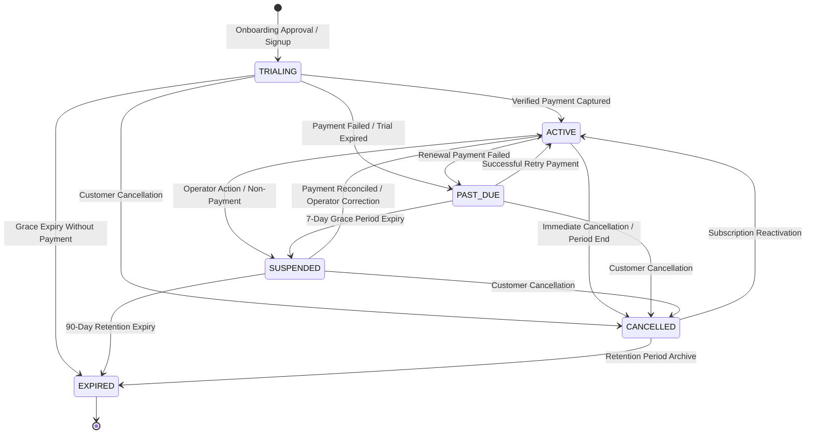
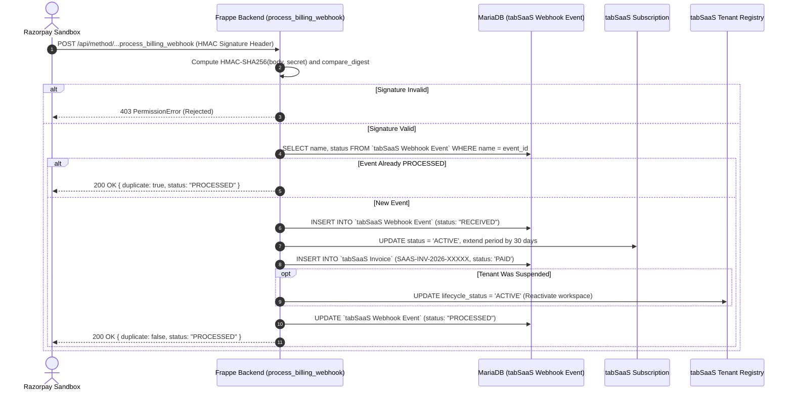

# SaaS Subscription Billing & Commercial Control Plane Architecture

**Milestone:** Phase 6 — SaaS Subscription Billing and Customer Self-Service Portal  
**Status:** `SANDBOX READY`  
**Date:** 2026-10-27  
**Authoritative Backend:** Central Control Plane Site (`frontend` / Frappe MariaDB)  

---

## 1. Executive Summary & Architectural Boundaries

Phase 6 implements the commercial control plane for the Departmental Store SaaS platform, allowing multiple independent store owners to subscribe to versioned software tiers, manage payment lifecycles, inspect capacity limits, download B2B tax receipts, and configure cancellation schedules.

### Strict Accounting & Operational Isolation
```
┌──────────────────────────────────────────────────────────────────────────────┐
│                    SaaS Platform Operator Control Plane                      │
│             (B2B Software as a Service Subscription Revenue)                 │
│                                                                              │
│  • B2B Tax Invoices: SAAS-INV-YYYY-XXXXX (GST SAC 998315 @ 18%)             │
│  • Provider: Razorpay Sandbox (HMAC-SHA256 Verified Webhooks)                │
│  • Isolated Tables: tabSaaS Subscription, tabSaaS Invoice, etc.              │
└──────────────────────────────────────┬───────────────────────────────────────┘
                                       │ Enforces Entitlements & Activation
                                       ▼
┌──────────────────────────────────────────────────────────────────────────────┐
│                    Tenant Store Workspaces (Frappe Sites)                    │
│                 (B2C Retail Store Sales & Grocery Inventory)                 │
│                                                                              │
│  • Retail Sales Invoices (POS-INV-YYYY-XXXXX) & GSTIN (e.g. 33AABCC1234D1Z5) │
│  • Counter SQLite Durable Offline Queue & ESC/POS Thermal Printing           │
│  • Authoritative Store Inventory, Batches, Price Lists, and Returns          │
└──────────────────────────────────────────────────────────────────────────────┘
```

> [!IMPORTANT]
> **Strict Separation Rule:**
> SaaS subscription payments are platform software revenue collected by the platform operator. They are **never** recorded as a store sale, never written to a tenant's POS ledger, and never mix with retail grocery sales, inventory items, or local GST filings.

---

## 2. Subscription Data Model & State Machine

Dedicated MariaDB tables prefixed with `tabSaaS ...` persist subscription state, customers, payment attempts, invoices, and webhook audit logs in the central control plane:

### A. Core Entity Relationships
- **`tabSaaS Customer Account`**: Tracks business legal name, billing contact, email, phone, state code (`33`), and optional customer GSTIN.
- **`tabSaaS Subscription Plan`**: Versioned tiers (`starter`, `growth`, `enterprise`) storing prices in paise (to prevent floating-point rounding), billing interval (`MONTHLY`, `ANNUALLY`), and server-enforced entitlements.
- **`tabSaaS Subscription`**: Current subscription instance linking `customer_id` and `tenant_id`, tracking lifecycle status, period boundaries, grace periods, and provider subscription IDs.
- **`tabSaaS Payment Transaction`**: Provider payment orders and transactions with statuses `PENDING`, `SUCCESS`, `FAILED`, `REFUNDED`.
- **`tabSaaS Invoice`**: Sequential B2B platform invoices (`SAAS-INV-YYYY-XXXXX`) recording subtotal, 18% GST, and PDF download links.
- **`tabSaaS Webhook Event`**: Raw webhook event storage with unique `event_id` primary keys for guaranteed idempotency and deduplication.
- **`tabSaaS Billing Audit Log`**: Immutable record of all state transitions, actor IDs, reasons, and timestamps.

### B. Subscription State Machine


### Allowed State Transitions Table
| Current State | Permitted Next States |
|---|---|
| `TRIALING` | `ACTIVE`, `PAST_DUE`, `SUSPENDED`, `CANCELLED`, `EXPIRED` |
| `ACTIVE` | `PAST_DUE`, `SUSPENDED`, `CANCELLED` |
| `PAST_DUE` | `ACTIVE`, `SUSPENDED`, `CANCELLED`, `EXPIRED` |
| `SUSPENDED` | `ACTIVE`, `CANCELLED`, `EXPIRED` |
| `CANCELLED` | `ACTIVE`, `EXPIRED` |
| `EXPIRED` | Terminal state (no outbound transitions) |

---

## 3. Plans & Server-Enforced Entitlements

| Plan Tier | Indicative Price | Counter Limit | SKU Limit | Staff Seats | Mobile Access | Batch / Expiry Alerts |
|---|---|---|---|---|---|---|
| **Starter Store** | ₹1,499 / mo | 1 Counter | 5,000 SKUs | 2 Seats | Shared Mobile Web | Standard |
| **Growth Multi-Counter** | ₹3,499 / mo | 5 Counters | 50,000 SKUs | 10 Seats | Shared Mobile App | Automated (7/30/60d) |
| **Departmental Premium** | ₹9,999 / mo | 25 Counters | 500,000 SKUs | 50 Seats | Custom Mobile Branding | 24/7 Dedicated Support |

### Server-Side Entitlement Guards
1. **POS Counter Registration (`devices.py`)**:
   When registering a new counter terminal via `register_device`, the server checks `active_counters < plan.max_counters`. If exceeded, registration fails with `ValidationError: Counter registration limit reached for current subscription plan. Upgrade plan in Manager Console -> Billing.`
2. **Non-Disruption of Live Sales**:
   Entitlement limits are enforced at device registration, employee account creation, or catalog batch sync. In-flight checkout sales transactions are **never** interrupted halfway through because a usage limit was reached.

---

## 4. Payment Provider & Webhook Reconciliation

### Provider Abstraction
- Currently configured with **Razorpay Sandbox** (key: `rzp_test_deptstore_sandbox`).
- Provider secrets are kept exclusively on the server (`RAZORPAY_WEBHOOK_SECRET`).
- Zero secret leakage: raw payment credentials, PANs, or private keys are never stored, logged, or bundled into client builds.

### Webhook Verification & Deduplication Pipeline


---

## 5. Customer Self-Service Portal

Implemented under `apps/owner-dashboard/src/app/(app)/billing`:
- **`/billing`**: Subscription overview, plan status badge, active counter utilization bar, recent platform invoices, and legal disclaimers.
- **`/billing/plans`**: Interactive comparison of Starter, Growth, and Enterprise tiers with live Sandbox checkout initiation.
- **`/billing/invoices`**: Complete invoice history with tax breakdown (Subtotal, 18% GST, Total INR) and PDF download actions.
- **`/billing/usage`**: Capacity meters for POS counters, catalog SKUs, and employee user accounts.
- **`/billing/cancel`**: Cancellation workflow detailing the 90-day data retention guarantee, timing choice (end of period vs immediate), and mandatory feedback collection.

---

## 6. Platform-Admin Billing Console

Implemented under `apps/owner-dashboard/src/app/(admin)/admin/billing`:
- **Global Overview**: Search customer accounts, filter by status (`ACTIVE`, `TRIALING`, `PAST_DUE`, `SUSPENDED`, `CANCELLED`), inspect linked tenant workspaces.
- **Manual Corrections**: Platform administrators can apply audited corrections to a customer's subscription status or extend billing days with a mandatory audit reason.
- **Webhook Reconciliation**: Real-time event log with failure diagnostics and a safe "Retry Event" replay action.
- **Strict Authorization Boundary**: Enforces `require_platform_admin()`. Tenant System Managers have zero access to platform billing operations.

---

## 7. Data Retention & Decommissioning Policy

- **No Silent Deletion**: Cancelling or expiring a subscription **never** drops the tenant's MariaDB database or deletes site files.
- **Suspension State**: When a subscription is cancelled immediately or expires past due, the tenant's status in `tabSaaS Tenant Registry` is transitioned to `SUSPENDED`.
- **90-Day Retention Guarantee**: Store records (catalog, barcode aliases, sales invoices, stock ledger) remain archived for at least 90 days.
- **Instant Reactivation**: Payment of an outstanding invoice or administrator reactivation restores full access immediately without data loss.

---

## 8. Release Gate & Remaining Blockers

### Current Release Target: `SANDBOX READY`
The billing state machine, checkout flow, webhook signature verification, invoice generation, customer self-service portal, and platform admin console have been verified 100% in local test and sandbox suites.

### Remaining Production Gates:
1. **Live Payment Gateway Activation**:
   - Production Razorpay Merchant Account activation with KYC verification.
   - Dedicated production webhook endpoint configured with production secret in environment.
2. **Legal & Terms Approval**:
   - Formal commercial sign-off on plan pricing (Starter ₹1,499 / Growth ₹3,499 / Enterprise ₹9,999).
   - Legal counsel review of SaaS Subscription Terms of Service, SLA guarantees, and Refund Policy.
3. **Accounting & Tax Review**:
   - Chartered Accountant sign-off on GST SAC code 998315 and platform operator GSTIN configuration.
   - Automated monthly reconciliation between Razorpay settlement reports and platform accounting ledger.
