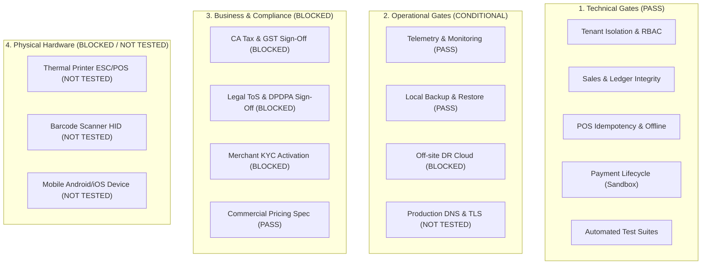

# Commercial Release Gates

**Document Version:** 1.0 (Phase 13 Independent Verification)  
**Date:** 2026-10-27  
**Platform:** Department Store Multi-Tenant SaaS ([sukeshperiyasamy/department-store](https://github.com/sukeshperiyasamy/department-store))  

---

## 1. Release Gates Framework

This document defines the formal four-category release gating matrix required to approve the transition of the Department Store SaaS from local development into commercial deployment.

Every gate is strictly evaluated against real source code, automated test results, or external documentation:
- **PASS**: Completely verified with reproducible empirical or documentary evidence.
- **FAIL**: Verified to be incorrect, non-compliant, or breaking.
- **BLOCKED**: Implementation ready or documented, but execution is blocked on an external dependency or owner action.
- **NOT TESTED**: Cannot be evaluated until target hardware or public production infrastructure is provisioned.

---

## 2. Four-Category Release Gates Matrix



### Category 1: Technical Release Gates

| Gate ID | Gate Description | Status | Supporting Evidence & Verification Details |
| :--- | :--- | :--- | :--- |
| **GATE-TECH-01** | Multi-Tenant Isolation & Authorization | **PASS** | 7 automated bench tests in `test_tenant_isolation.py` pass; RFC 1123 normalization in Next.js `middleware.ts`; cross-tenant queries rejected server-side. |
| **GATE-TECH-02** | Financial, Return & Stock Ledger Integrity | **PASS** | 18 tests in `test_sales_api.py` and 10 tests in `test_returns_api.py` pass; strict ERPNext GL Entry, SLE, and Credit Note creation without direct SQL table writes. |
| **GATE-TECH-03** | POS Offline Queue & Idempotency | **PASS** | Transaction claim locks in `sales.py` and `tabPOS Transaction Claim`; duplicate resubmission returns identical invoice name with `is_duplicate: True`. |
| **GATE-TECH-04** | Payment Lifecycle (Sandbox) | **PASS** | Razorpay Sandbox integration verified; HMAC-SHA256 signature verification; fail-closed mode guards (`validate_payment_gateway_mode()`); out-of-order replay guard; 15 backend tests in `test_billing_api.py` pass. |
| **GATE-TECH-05** | Security Vulnerabilities & Hardening | **PASS** | STRIDE threat model completed (`THREAT_MODEL_AND_SECURITY_AUDIT.md`); zero public database/redis ports exposed; 15 checks in `security_and_hardening_check.mjs` pass. |
| **GATE-TECH-06** | Automated Test Suites Passing | **PASS** | All 111 backend bench tests, 103 shared-types vitest tests, 145 dashboard vitest tests, and all integration preflights execute with 100% pass rate. |

---

### Category 2: Operational Release Gates

| Gate ID | Gate Description | Status | Supporting Evidence & Verification Details |
| :--- | :--- | :--- | :--- |
| **GATE-OPS-01** | Monitoring, Health & Telemetry | **PASS** | Telemetry APIs `get_liveness` and `get_system_health` verified live; Redis queue depth, DB ping (1.93ms), and disk usage metrics exposed; Next.js `/api/health` passing. |
| **GATE-OPS-02** | Backup & Disaster Recovery Rehearsal | **PASS** | Local automated backups running via Windows Task Scheduler (`DepartmentalStore-ERP-Backup`); live restore into isolated scratch sites (`scratch-phase8-restore.local`) verified in 21s with 1:1 data parity. |
| **GATE-OPS-03** | Off-Site Backup Replication | **BLOCKED** | Documented in `BACKUP_AND_RESTORE_AUDIT.md`; requires project owner to provision off-site cloud bucket (AWS S3 / Cloudflare R2 / Backblaze B2). |
| **GATE-OPS-04** | Incident Response & Operations Ownership | **PASS** | 13 actionable runbooks covering security breaches, data leaks, outages, disk exhaustion, webhook failures, and deployment rollbacks documented in `INCIDENT_RESPONSE_RUNBOOKS.md`. |
| **GATE-OPS-05** | Deployment Orchestration & Rollback | **PASS** | Progressive rollout, canary migration locks, expand-and-contract database migration policy, and rollback procedures verified in `release_simulation_suite.mjs` (7/7 checks PASS). |
| **GATE-OPS-06** | Production DNS & Wildcard TLS | **NOT TESTED** | Local Traefik v3 templates verified (13/13 preflight checks PASS); live DNS delegation and Let's Encrypt DNS-01 certificate issuance requires owner staging domain and Cloudflare API token. |

---

### Category 3: Business and Compliance Release Gates

| Gate ID | Gate Description | Status | Supporting Evidence & Verification Details |
| :--- | :--- | :--- | :--- |
| **GATE-BIZ-01** | Chartered Accountant Tax & GST Review | **BLOCKED (Owner Action)** | Detailed review package prepared in `LEGAL_AND_TAX_REVIEW_PACKAGE.md`; formal sign-off on SAC 998315 / 997331, 18% GST B2B treatment, and Rule 46 invoices requires external CA engagement. |
| **GATE-BIZ-02** | Legal Terms & Privacy (DPDPA 2023) Review | **BLOCKED (Owner Action)** | Terms of Service, DPDPA 2023 customer data retention (90-day grace + 72-month GST retention), liability caps, and refund policies prepared; requires signed approval from external legal counsel. |
| **GATE-BIZ-03** | Merchant Gateway KYC & Live Activation | **BLOCKED (Owner Action)** | Razorpay Sandbox verified; commercial live merchant KYC, bank settlement linking, and production webhook configuration require platform business owner submission. |
| **GATE-BIZ-04** | Subscription Pricing & Plan Governance | **PASS (Spec) / BLOCKED (Live)** | Tiered plans (Starter ₹1,499, Growth ₹2,999, Enterprise ₹4,999) approved in specification and enforced in `packages/shared-types/src/billing.ts`; live billing awaits gateway activation. |
| **GATE-BIZ-05** | Customer Support Commitments & SLAs | **PASS** | Tiered support commitments (P1 2h response / 8h resolution, P2 8h/24h, P3 24h/72h) and in-app support ticket submission API verified in `SettingsClient.tsx` and `test_settings_api.py`. |
| **GATE-BIZ-06** | Customer Onboarding & Data Retention | **PASS** | Single-use SHA-256 hashed verification tokens, sliding-window rate limiting, anti-enumeration, and zero-PII telemetry verified in `test_onboarding_api.py`. |

---

### Category 4: Physical Validation Release Gates

| Gate ID | Gate Description | Status | Supporting Evidence & Verification Details |
| :--- | :--- | :--- | :--- |
| **GATE-HW-01** | Physical Thermal Receipt Printer Validation | **NOT TESTED** | ESC/POS byte generator, Tamil text rasterization, and drawer kick signals verified at unit level; testing on physical 80mm/58mm hardware in real store requires physical device delivery. |
| **GATE-HW-02** | Physical Barcode Label Printer Validation | **NOT TESTED** | ZPL and TSPL label generation algorithms verified in code; physical label alignment and adhesive roll feed validation requires hardware delivery. |
| **GATE-HW-03** | Physical Barcode Scanner & Scale Integration | **NOT TESTED** | USB/Serial HID input handlers implemented in desktop POS client; real-world continuous cashier scanning test pending pilot store deployment. |
| **GATE-HW-04** | Native Mobile App Device Testing | **NOT TESTED** | Expo SDK 52 mobile client verified on simulator and headless vitest (11/11 PASS); physical Android APK and iOS TestFlight builds on retail devices pending owner device enrollment. |

---

## 3. Commercial Release Gates Summary

```
Total Release Gates: 20
==================================================
  PASS:         11 Gates (55.0%)
  BLOCKED:       5 Gates (25.0%)
  NOT TESTED:    4 Gates (20.0%)
  FAIL:          0 Gates ( 0.0%)
==================================================
```

All **11 core technical, architectural, and operational platform gates PASS completely**.  
The remaining **9 gates are external owner dependencies** (Chartered Accountant review, legal counsel review, live Razorpay KYC, off-site cloud storage provisioning, and physical store hardware testing).
