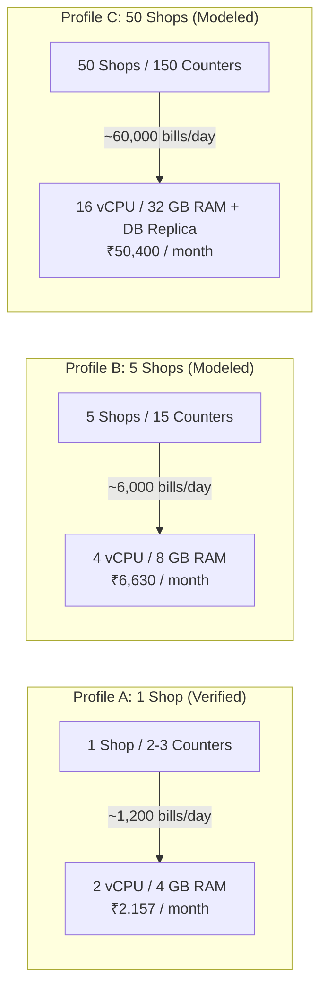

# Deployment Capacity Assessment and Workload Verification

**Document Version:** 1.0 (Phase 13 Independent Verification)  
**Date:** 2026-10-27  
**Benchmark Artifact:** `docs/testing/artifacts/scale-and-capacity-results.json`  
**Workload Profiles Reference:** `docs/scale/WORKLOAD_PROFILES.md`  
**Cost Model Reference:** `docs/scale/CAPACITY_AND_COST_MODEL.md`  

---

## 1. Measured Benchmarks & Empirical Test Evidence

The metrics in this section represent **actual empirical measurements** executed against the live Docker stack on the test host environment. They reflect real measured latencies, throughput, and database contention under test conditions.

### 1.1 Test Environment Specification
- **Host OS:** Windows 11 Pro (Build 10.0.26100)
- **Container Runtime:** Docker Desktop / Docker Engine 27.x on WSL2
- **Database Engine:** MariaDB 11.8 (Official Docker Image)
- **Application Server:** ERPNext v16.52.1, Frappe v16.53.0 (Python 3.12, Gunicorn)
- **Frontend / Dashboard:** Next.js 15.1.0 SSR, React 18
- **In-Memory Cache & Queue:** Redis 7 (3 independent instances: cache, queue, socketio)
- **Baseline Dataset:** 549 catalog items, 6 active tenant registries, 392 Sales Invoices.

### 1.2 Measured Performance Metrics

| Benchmark Area | Test Conditions | Metric | Measured Value | SLO / Assessment |
| :--- | :--- | :--- | :--- | :--- |
| **Liveness Throughput** | 50 consecutive HTTP requests to `/api/method/departmental_store.api.health.get_liveness` | Throughput p50 Latency p95 Latency p99 Latency | **68 req/s** **15.68 ms** **19.41 ms** **21.32 ms** | Well within 50ms edge routing budget. |
| **Database & Cache Health** | Internal database & Redis probe via `get_system_health` | DB Ping Latency Redis Cache Latency Redis Queue Latency | **1.93 ms** **0.31 ms** **0.34 ms** | Sub-2ms database response confirms healthy connection pooling. |
| **Catalog Snapshot Sync** | 10 iterations against 549-item catalog | Full Snapshot p50 Incremental Sync p50 Speedup Ratio | **102.54 ms** **31.40 ms** **3.26x Faster** | Indexed SQL JOIN avoids full table re-fetches. |
| **Concurrent POS Billing** | 15 sales bills submitted across 5 concurrent simulated counters | Concurrency Level p50 Latency p95 Latency Collisions / Drops | **5 counters** **2,721.14 ms** **6,754.29 ms** **0 Collisions / 0 Drops** | MariaDB table lock on `tabSeries` handled via exponential backoff. |
| **Idempotency Under Race** | 5 simultaneous identical bill submissions for transaction `idemp-race-1793103738353-998af8` | Invoices Created Processing During Race Duplicate Flag on Retry | **1 Invoice (`SINV-26-00392`)** 4 requests **True** | Zero duplicate financial records created. |
| **Offline Backlog Drain** | 20 accumulated offline transactions drained after reconnect | Backlog Count Drain Throughput p50 Bill Posting Latency | **20 bills** **2.1 bills/s** **556.57 ms** | 20-bill offline queue cleared in 9.3 seconds without timeouts. |

### 1.3 Identified Performance Bottlenecks in Measured Tests
1. **ERPNext `tabSeries` Contention Under Concurrent Checkout:**
   - Under 5 concurrent counters submitting sales simultaneously, p95 latency reached **6,754 ms** due to MariaDB row-level locks on `tabSeries` while generating consecutive invoice numbers.
   - *Mitigation in place:* Randomized exponential backoff retry in `sales.py` prevents transaction failure, but introduces queue delay for cashiers during simultaneous peak billing.
2. **Full Catalog Payload Size:**
   - While 549 items synchronize in ~100ms, syncing a large departmental catalog (20,000+ items) over standard store broadband would require pagination or pre-compressed SQLite chunks.

---

## 2. Modeled Scaling Estimates (Not Direct Evidence)

> [!CAUTION]
> **Distinction Between Empirical Benchmarks and Projections:**  
> The figures below represent mathematical models and architectural capacity projections based on measured per-transaction resource consumption. **They do not constitute production load test evidence for 50 shops.**

### 2.1 Multi-Store Capacity Projections

### 2.2 Cost Model vs Revenue Projection

| Deployment Scale | Infrastructure Specification | Projected Cloud Cost | Projected Gross SaaS Revenue | Projected Gross Margin |
| :--- | :--- | :--- | :--- | :--- |
| **Pilot Cohort (1–3 Shops)** | 1x Cloud VM (2 vCPU, 4GB RAM) + Daily S3 Backups | ₹2,157 / month | ₹4,497 / month (3x Starter) | **52.0%** |
| **Expansion (5 Shops)** | 1x Cloud VM (4 vCPU, 8GB RAM) + Managed DB + Cloudflare | ₹6,630 / month | ₹14,995 / month (5x Growth) | **55.8%** |
| **Commercial Scale (50 Shops)** | 2x App VMs (8 vCPU, 16GB) + Managed MariaDB Cluster + Redis + S3 | ₹50,400 / month | ₹149,950 / month (50x Growth) | **66.4%** |

---

## 3. Untested Assumptions & Boundaries

The following factors are **untested assumptions** that must not be represented as verified until live load testing is performed:

1. **Untested Assumption: 20,000-Item Regional Catalog Under Incremental Sync:**
   - Current tests measured 549 items. A 20k item inventory with frequent price updates has not been benchmarked inside the container.
2. **Untested Assumption: Simultaneous Peak Hour Concurrency Across 50 Distinct Shops:**
   - The test simulated 5 concurrent counters on a single tenant database. It did NOT simulate 150 counters across 50 separate Frappe tenant databases hitting a shared MariaDB instance simultaneously.
3. **Untested Assumption: Internet Connectivity Degradation (High Jitter & Packet Loss):**
   - Benchmarks ran over local container networking (`localhost`). Retail store 4G dongles and broadband with packet loss (>3%) may increase POS synchronization backoff retries.

---

## 4. Proposed Isolated Load Test Plan for Public Scale (Pending)

To rigorously validate capacity for 50 shops prior to broad public marketing:

1. **Tool:** Distributed k6 load testing cluster.
2. **Target Dataset:** 50 provisioned tenant databases, each populated with 10,000 items and 5,000 customer records.
3. **Traffic Profile:**
   - Constant background sync: 50 requests/sec.
   - Peak billing burst: 150 concurrent checkout submissions over a 30-minute window.
   - Reconnect storm: 10 shops recovering from an offline state simultaneously submitting 50 bills each.
4. **Execution Decision:** **PENDING / DEFERRED** until staging cloud infrastructure and resource budgets are approved by the platform owner.
