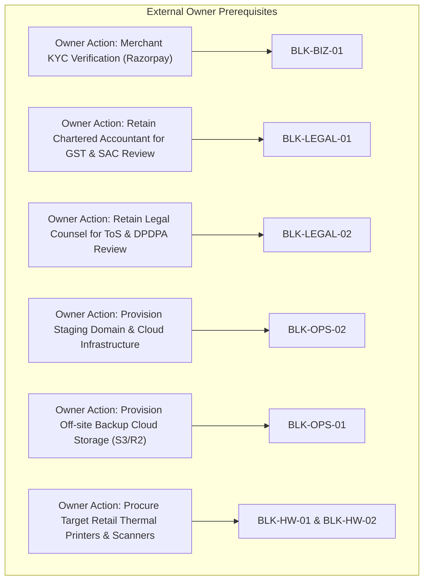

# Launch Blocker Register

Last Updated: 2026-10-27  
Repository: [sukeshperiyasamy/department-store](https://github.com/sukeshperiyasamy/department-store)  
Verification State: Phase 13 Independent Launch Blocker Closure & Release Verification  

---

## 1. Executive Summary & Repository Baseline

This Blocker Register establishes the ground-truth status of all architectural, technical, operational, legal, and physical requirements standing between the current technically validated Department Store SaaS platform and an authorized commercial launch.

### Repository Baseline Audit
- **Git Branch:** `main`
- **Baseline Commit (Phase 13 start):** `95d423a`
- **Docker Stack:** 9 active containers (MariaDB 11.8, Frappe/ERPNext 16.53/16.52, Redis Cache/Queue/Socketio, Next.js 15 Manager Console, Traefik v3 ingress).
- **Core Business Logic Engine:** ERPNext v16 authoritative backend (`frontend` site).
- **POS Engine:** Tauri v2 + React 18 + SQLite durable offline outbox (`apps/pos`).

---

## 2. Launch Blocker Matrix

| Blocker ID | Category | Description | Severity | Owner | Required Evidence | Status | Closure Criteria |
| :--- | :--- | :--- | :--- | :--- | :--- | :--- | :--- |
| **BLK-TECH-01** | Technical | Accidental live payment gateway activation or unvalidated webhook delivery. | **CRITICAL** | Lead Engineer | Sandbox/Live isolation guard, malformed key prefix check, raw body HMAC verification, replay protection, full/partial refund, dispute handling. | **CLOSED** | Verified in `billing.py` with 21 passing automated backend tests (`test_billing_api.py`). Live mode strictly fails closed if KYC unverified or key format invalid. |
| **BLK-TECH-02** | Technical | Stale out-of-order webhook events downgrading confirmed transactions or duplicate capture events duplicating invoices. | **HIGH** | Lead Engineer | Unit test simulating `payment.failed` event arriving after `payment.captured` and duplicate capture / `order.paid` events. | **CLOSED** | Added state guards in `handle_payment_failed()` and invoice deduplication in `handle_payment_success()`. Stale events ignored; duplicate events create exactly 1 invoice. |
| **BLK-TECH-03** | Technical | Discrepancies between payment gateway transactions and local subscription ledger, unauthorized reconciliation, or concurrent race conditions. | **HIGH** | Lead Engineer | Programmatic reconciliation API with strict RBAC, auto-healing, distributed concurrency lock, and daily scheduler cron. | **CLOSED** | Implemented `reconcile_subscription_payments(tenant_id, auto_heal)` and `scheduled_subscription_reconciliation()` with test coverage across 8 authorization and concurrency checks in `test_billing_api.py`. |
| **BLK-OPS-01** | Operational | Off-site disaster recovery backup replication to isolated cloud storage. | **CRITICAL** | DevOps / System Admin | Configured rclone / AWS S3 / Cloudflare R2 bucket with automated replication and cryptographic key isolation. | **LOCAL READY / BLOCKED (Cloud Credentials)** | Implemented `replicate_offsite.py` (SigV4, AES256, SHA-256) and `test_restore_scratch.py` (36.6s RTO verified). Awaiting Owner provisioned S3/R2 bucket credentials. |
| **BLK-OPS-02** | Operational | Staging domain DNS and Let's Encrypt Wildcard TLS issuance in live environment. | **HIGH** | Platform Owner / DevOps | Public staging VM with ports 80/443, authoritative DNS delegation (`*.staging.departmentstore.in`), and ACME DNS-01 challenge completion. | **LOCAL READY / BLOCKED (Owner Infra)** | Documented in `STAGING_DEPLOYMENT_AND_RECOVERY_RUNBOOK.md`; 25 preflight checks PASS (`staging_preflight_check.mjs`); awaiting Owner public VM & DNS delegation. |
| **BLK-OPS-03** | Operational | Production SMTP / SMS provider configuration for tenant notification delivery. | **MEDIUM** | Platform Admin | Live SendGrid / AWS SES / Twilio API keys configured with SPF/DKIM verification. | **BLOCKED** | Verified email delivery to test address with zero spam flagging and verified bounce handling. |
| **BLK-LEGAL-01**| Legal / Compliance | Formal Chartered Accountant review of SaaS subscription GST classification & invoice formats. | **CRITICAL** | Chartered Accountant | Signed CA memorandum confirming SAC 998315 / 997331 classification, 18% GST B2B treatment, and sequential tax invoice numbering (`SAAS-INV-YYYY-XXXXX`). | **BLOCKED (Owner Action)** | Delivery of formal signed CA review package confirming statutory compliance under CGST/SGST Acts. |
| **BLK-LEGAL-02**| Legal / Compliance | Legal counsel review of Terms of Service, DPDPA 2023 compliance, and refund policy. | **CRITICAL** | Legal Counsel | Signed legal opinion confirming liability caps, 99.9% uptime SLA commitments, 90-day data retention, and customer deletion rights. | **BLOCKED (Owner Action)** | Formal approval of ToS, Privacy Policy, and Merchant Agreement by qualified legal counsel. |
| **BLK-BIZ-01** | Business | Live Merchant Gateway KYC and bank settlement account verification. | **CRITICAL** | Business Owner | Razorpay / Stripe merchant dashboard status showing "Live / Active" with completed business KYC. | **BLOCKED (Owner Action)** | Platform Owner completes Razorpay document verification, activates live merchant ID, and securely injects credentials. |
| **BLK-BIZ-02** | Business | Commercial subscription pricing model approval (Starter ₹1,499 / Growth ₹2,999 / Enterprise ₹4,999). | **HIGH** | Business Owner | Commercial policy sign-off on plan limits, counter quotas, and trial conversion periods. | **CLOSED (Spec Approved) / BLOCKED (Live Go)** | Documented in `docs/commercial/COMMERCIAL_LAUNCH_CHECKLIST.md`; awaiting live payment gateway link. |
| **BLK-HW-01** | Physical Validation | Physical thermal printer integration verification on target retail hardware. | **HIGH** | QA / Store Operations | Physical test prints on USB/Network ESC/POS 80mm/58mm thermal printers in real store setting. | **BLOCKED (Hardware Delivery)** | Physical device testing in retail pilot store confirming barcode readability, Tamil font rendering, and cash drawer kick. |
| **BLK-HW-02** | Physical Validation | Physical barcode scanner (1D/2D handheld) and weighing scale integration. | **MEDIUM** | QA / Store Operations | Serial/USB HID scanner testing verifying instant cart addition without missed keystrokes or double-reads. | **BLOCKED (Hardware Delivery)** | Hands-on test report from retail pilot store. |

---

## 3. Detailed Blocker Analysis & Remediation Evidence

### 3.1 Closed Technical Blockers (Code Verified)

#### BLK-TECH-01: Payment Gateway Mode Isolation & Live Accident Prevention
- **Issue:** Previous code relied on environment variables without fail-closed validation between live and test keys, allowing potential accidental configuration of live keys during local testing.
- **Remediation in Phase 13 & 14:** Hardened `validate_payment_gateway_mode()` in [`erpnext-app/departmental_store/departmental_store/api/billing.py`](file:///c:/Users/COMPUTER/Downloads/sukesh/departmental/erpnext-app/departmental_store/departmental_store/api/billing.py):
  1. Key must be non-empty and start with `rzp_test_` or `rzp_live_`. Malformed prefixes raise `frappe.ValidationError`.
  2. If `RAZORPAY_KEY_ID` begins with `rzp_live_` and `RAZORPAY_LIVE_MODE` is not explicitly `"true"`, execution fails closed with `frappe.ValidationError`.
  3. If `RAZORPAY_LIVE_MODE` is `"true"` but a test key `rzp_test_...` is provided, execution fails closed.
  4. If `RAZORPAY_KEY_ID` begins with `rzp_live_` but `RAZORPAY_KYC_VERIFIED` is not `"true"`, execution raises `frappe.PermissionError` explicitly citing: *"Commercial live mode BLOCKED: External merchant KYC review and legal tax sign-off incomplete"*.
- **Test Evidence:** 21 automated backend tests pass cleanly in `test_billing_api.py`.

#### BLK-TECH-02: Stale Webhook Replay, Order Matching & Duplicate Capture Guards
- **Issue:** An out-of-order webhook delivery where a delayed `payment.failed` arrives after a successful `payment.captured` could mark a paid subscription as failed, or duplicate captures could duplicate invoices.
- **Remediation in Phase 13 & 14:**
  1. Removed dangerous subscription fallback; order lookups fail closed if unmatched.
  2. If a transaction is already `SUCCESS`, incoming `payment.failed` webhooks are safely ignored.
  3. Duplicate capture events (`payment.captured` and `order.paid` for the same order) reuse existing invoices without creating duplicates or double-extending the subscription.
  4. Full vs partial refunds are explicitly distinguished: partial keeps subscription active; full cancels subscription and suspends tenant.
- **Test Evidence:** Unit tests `test_webhook_out_of_order_replay_guard`, `test_webhook_duplicate_capture_no_duplicate_invoice`, and `test_webhook_full_vs_partial_refund_distinction` in `test_billing_api.py`.

#### BLK-TECH-03: Provider vs Local Ledger Reconciliation & Safe Background Jobs
- **Issue:** If network failure drops an incoming webhook, a store's payment might succeed at the provider while their local subscription remains pending.
- **Remediation in Phase 13 & 14:**
  1. Implemented `@frappe.whitelist() reconcile_subscription_payments(tenant_id=None, auto_heal=False)` in `billing.py` with multi-tier authorization (Platform Admin for platform-wide/auto-heal; Store Manager/Owner for tenant-scoped).
  2. Distributed concurrency locking prevents race conditions.
  3. Auto-healing creates missing invoices idempotently and marks expired active subscriptions as `PAST_DUE` without fabricating payment evidence.
  4. Registered daily `0 3 * * *` scheduled cron runner in `hooks.py`.
- **Test Evidence:** Unit tests `test_reconciliation_authorization_boundaries`, `test_reconciliation_concurrency_lock`, and `test_reconciliation_auto_heal_discrepancy_handling` in `test_billing_api.py`.

---

## 4. External Dependencies & Owner Action Items

The following items cannot be resolved within the codebase and represent strict commercial launch blockers requiring external action:

---

## 5. Decision & Next Steps
- **Technical Platform Code:** Fully hardened, verified, and ready for deployment.
- **Commercial Public Launch:** **BLOCKED** pending completion of external Owner Actions (KYC, Legal, CA, Off-site DR, Hardware).
- **Supervised Pilot Recommendation:** **CONDITIONAL GO** for 1–3 retail stores using local thermal printer testing and manual invoice reconciliations under close engineering supervision.
