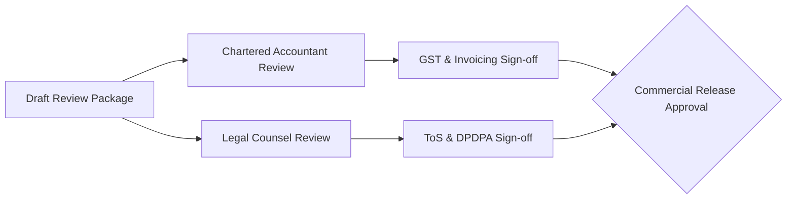

# Commercial Launch Review Package: Legal, Accounting & Tax Compliance

**Document Version:** 1.0 (Draft for Professional Review)  
**Date:** 2026-10-27  
**Jurisdiction:** Republic of India (Central Goods and Services Tax Act, 2017; State GST Acts; Digital Personal Data Protection Act, 2023)  
**Target Entities:**
1. Qualified Chartered Accountant (FCA / Practicing Member of ICAI)
2. Qualified Legal Counsel (Advocate / Corporate Legal Advisor)
**System Under Review:** Department Store Multi-Tenant SaaS Platform ([sukeshperiyasamy/department-store](https://github.com/sukeshperiyasamy/department-store))  

---

> [!IMPORTANT]
> **Statutory Notice & Status:**  
> The tax classifications, SAC codes, contractual terms, privacy policies, and SLA commitments detailed in this document represent the proposed technical implementation of the Department Store SaaS platform. Under engineering safety guidelines, all statutory interpretations, tax treatments, and legal liabilities remain **UNAPPROVED and INACTIVE** until formal review, modification, and signed approval are provided by qualified professionals. No live commercial tax invoices may be issued prior to this sign-off.

---

## 1. Review Package Overview for the Chartered Accountant

### 1.1 Commercial Subscription Plans & Pricing Structure

The platform proposes three recurring software-as-a-service (SaaS) subscription tiers for departmental and grocery retailers:

| Plan Identifier | Plan Name | Base Price (INR / Month) | Max Billing Counters | Target Retail Format | Proposed B2B GST Rate |
| :--- | :--- | :--- | :--- | :--- | :--- |
| `starter` | **Starter** | ₹1,499.00 | 1 Counter | Single-counter local kirana / convenience store | 18% (Forward Charge) |
| `growth` | **Growth** | ₹2,999.00 | 3 Counters | Multi-counter departmental store (supermarket) | 18% (Forward Charge) |
| `enterprise` | **Enterprise** | ₹4,999.00 | 10 Counters | Large departmental store / multi-floor retail | 18% (Forward Charge) |

*Notes:*
- Annual billing offers a 2-month discount (e.g., Starter Annual = ₹14,990/year).
- Additional billing counters beyond plan quotas are billed at ₹499/counter/month.

### 1.2 Proposed GST Classification & Tax Treatment (SAC Code)

| Statutory Field | Proposed Classification | Statutory Rationale for CA Evaluation |
| :--- | :--- | :--- |
| **Service Accounting Code (SAC)** | **998315** *(Hosting and infrastructure provisioning services)* or **997331** *(Licensing services for the right to use computer software)* | Cloud-hosted SaaS model with continuous multi-tenant ERP access, automated offsite database backups, and local Windows POS synchronisation. |
| **Applicable Tax Type** | **CGST (9%) + SGST (9%)** or **IGST (18%)** | Intra-State supply (Supplier in Tamil Nadu, Customer in Tamil Nadu) = 9% CGST + 9% SGST. Inter-State supply = 18% IGST. |
| **Reverse Charge Mechanism (RCM)** | **No** | Standard forward charge supply by registered corporate/LLP supplier. |
| **Place of Supply (POS)** | State where recipient is registered for GST (as per Section 12(2) of IGST Act). For unregistered retailers, address on record. | Address and State validated during tenant registration; GSTIN state code verified against recipient GSTIN prefix (e.g. `33` for Tamil Nadu). |
| **Composition Scheme Retailers** | Normal 18% GST charged on SaaS invoice | The subscriber cannot claim Input Tax Credit (ITC) if registered under Composition Scheme, but SaaS operator must levy standard 18% tax. |

### 1.3 Proposed SaaS B2B Tax Invoice Numbering & Layout

In accordance with Rule 46 of the CGST Rules, 2017:
- **Invoice Number Format:** Consecutive serial numbering not exceeding 16 characters containing alphabets, numerals, and special characters (`-` and `/`):
  - Proposed Template: `SAAS-2627-XXXXX` (reset annually on April 1st).
- **Mandatory Fields Populated by System:**
  1. Supplier Legal Name, Registered Office Address, and GSTIN.
  2. Sequential Invoice Number and Date of Issue.
  3. Customer Legal Business Name, Billing Address, State Code, and GSTIN (if registered).
  4. SAC Code (998315).
  5. Taxable Value of SaaS subscription.
  6. Rate and Amount of Tax (itemized as CGST/SGST or IGST).
  7. Payment Reference (Razorpay Transaction ID) and Payment Status.
  8. Cryptographic hash / QR Verification code.

### 1.4 Subscription Cancellation, Proration & Credit Notes

Under the current technical design:
1. **Mid-Cycle Cancellation:** Customers may cancel subscriptions at any time via the self-service billing portal (`/billing/cancel`). Access continues until the end of the paid billing cycle (`current_period_end`). No partial mid-month cash refunds are issued automatically.
2. **Defective Service / Goodwill Refunds:** Authorized platform administrators may trigger a refund via the platform admin console (`/admin/billing`). When a refund is granted:
   - A standard GST Credit Note must be issued in accordance with Section 34 of the CGST Act.
   - Proposed Credit Note Format: `SAAS-CN-2627-XXXXX`.
   - Credit Note links directly to the original Tax Invoice number.

---

## 2. Review Package Overview for Legal Counsel

### 2.1 Terms of Service & Software License Structure

The platform operates as a hybrid SaaS and on-premise local agent model:
- **Central Control Plane:** Web-based ERP and management dashboard hosted on cloud infrastructure.
- **Local Counter Agent:** Native Windows POS client running locally on cashier hardware with an embedded SQLite database for offline billing.

Key contractual terms requiring legal review:
1. **Limited Software License:** Non-exclusive, non-transferable, revocable license to access the cloud services and install the desktop POS client for the registered tenant entity only.
2. **Prohibition of Reverse Engineering & Tampering:** Users shall not decompile, reverse engineer, intercept network communications, or tamper with software licensing checks or device limits.
3. **Hardware Responsibility:** The customer retailer is solely responsible for procuring, configuring, and maintaining compatible POS hardware (thermal printers, barcode scanners, barcode labels, and stable electrical power).
4. **Offline Billing Disclaimer:** The software provides an offline billing fallback during internet disruptions. The customer acknowledges that offline billing does not guarantee real-time multi-counter inventory locking, and the platform bears no liability for store-level physical overselling during disconnected periods.

### 2.2 Digital Personal Data Protection Act (DPDPA), 2023 Compliance

The platform processes business contact data and retail customer transaction records:

| Data Category | Data Elements Processed | Purpose of Processing | Proposed Retention Policy |
| :--- | :--- | :--- | :--- |
| **Tenant Administrator Data** | Full Name, Mobile Phone Number, Business Email, Store Physical Address, GSTIN | Contract performance, tenant verification, billing, critical operational alerts | Retained for duration of active subscription + 8 years statutory tax audit window |
| **Store Retail Shopper Data** | Customer Phone Number (optional for e-receipt / SMS bill) | Generating GST invoice, sending digital receipt, store loyalty lookup | Retained strictly within the tenant's isolated database; platform operator does not aggregate or sell shopper data |
| **System Telemetry & Logs** | IP address, User Agent, API request timestamps, latency, error stacks | Platform security, fraud prevention, service reliability, DDoS mitigation | 90 days rolling retention; sanitized of passwords, tokens, and PII |

**Key Legal Considerations:**
- **Right to Erasure / Account Closure:** When a tenant terminates their subscription, their database remains in `SUSPENDED` status for 90 days (grace period for reactivation or data export). After 90 days, upon written request, tenant databases may be purged, subject to statutory record retention requirements under Section 36 of the CGST Act (mandatory 72-month retention of financial records).
- **No Third-Party Advertising:** The platform contains zero third-party behavioral advertising trackers, data brokers, or marketing surveillance SDKs.

### 2.3 Service Level Agreement (SLA) & Liability Limitations

The proposed commercial terms include:
1. **Target Availability SLA:** 99.9% monthly uptime for the central cloud API and management console (excluding scheduled maintenance announced with 48 hours notice).
2. **SLA Breach Remedy:** Sole remedy for SLA breach shall be service fee credits (e.g., 5% credit for 99.0%–99.5% uptime; 10% credit for <99.0% uptime). Cash refunds are excluded.
3. **Liability Cap:** To the maximum extent permitted by applicable Indian law, the platform operator's total aggregate liability arising out of or related to the software services shall be strictly capped at the **total fees paid by the customer to the platform operator in the preceding three (3) calendar months**.
4. **Exclusion of Consequential Damages:** Complete exclusion of liability for loss of business profits, retail store downtime, corrupt retail hardware, inventory theft, or regulatory penalties imposed on the retailer by tax authorities.

---

## 3. Formal Review & Sign-Off Checklist

This checklist must be executed by authorized external professionals prior to public commercial launch.

### Review Status Tracker

| Area | Review Item | Assigned Reviewer | Review Date | Decision | Conditions / Outstanding Actions |
| :--- | :--- | :--- | :--- | :--- | :--- |
| **Taxation** | SaaS Subscription SAC Code (998315 vs 997331) | External Chartered Accountant | *Pending* | **UNAPPROVED (Owner Action)** | Awaiting CA written opinion on optimal SAC classification. |
| **Taxation** | GST Invoicing Rule 46 Compliance & Format | External Chartered Accountant | *Pending* | **UNAPPROVED (Owner Action)** | Verification of 16-character alphanumeric sequence and state code rules. |
| **Taxation** | Credit Note & Refund Treatment under GST | External Chartered Accountant | *Pending* | **UNAPPROVED (Owner Action)** | Formal sign-off on Section 34 credit note workflows. |
| **Legal** | SaaS Subscription Terms of Service (ToS) | External Legal Counsel | *Pending* | **UNAPPROVED (Owner Action)** | Legal review of liability cap (3 months fees) and hardware disclaimer. |
| **Legal** | Privacy Policy & DPDPA 2023 Compliance | External Legal Counsel | *Pending* | **UNAPPROVED (Owner Action)** | Verification of data fiduciary obligations and 72-month GST retention conflict. |
| **Legal** | Refund & Cancellation Policy | External Legal Counsel | *Pending* | **UNAPPROVED (Owner Action)** | Review of no-refunds mid-month policy and consumer protection compliance. |
| **Banking** | Razorpay Live Merchant KYC & Settlement | Platform Business Owner | *Pending* | **BLOCKED (Owner Action)** | Submission of business PAN, bank account, and GSTIN to payment gateway. |

---

## 4. Professional Deliverables Required for Release Gate Closure

To transition release gate **`BLK-LEGAL-01`**, **`BLK-LEGAL-02`**, and **`BLK-BIZ-01`** from **BLOCKED** to **CLOSED**, the platform owner must obtain and archive the following documents in `docs/launch/evidence/`:

1. **`CA_GST_OPINION_SIGNED.pdf`**: Signed letterhead memorandum from a practicing FCA certifying SAC classification, invoice templates, and credit note procedures.
2. **`LEGAL_TOS_AND_PRIVACY_APPROVAL.pdf`**: Final redlined or signed Terms of Service and Privacy Policy approved by legal counsel.
3. **`RAZORPAY_LIVE_KYC_CONFIRMATION.pdf`**: Screenshot or certificate from Razorpay dashboard confirming active live merchant status with verified bank settlements.
