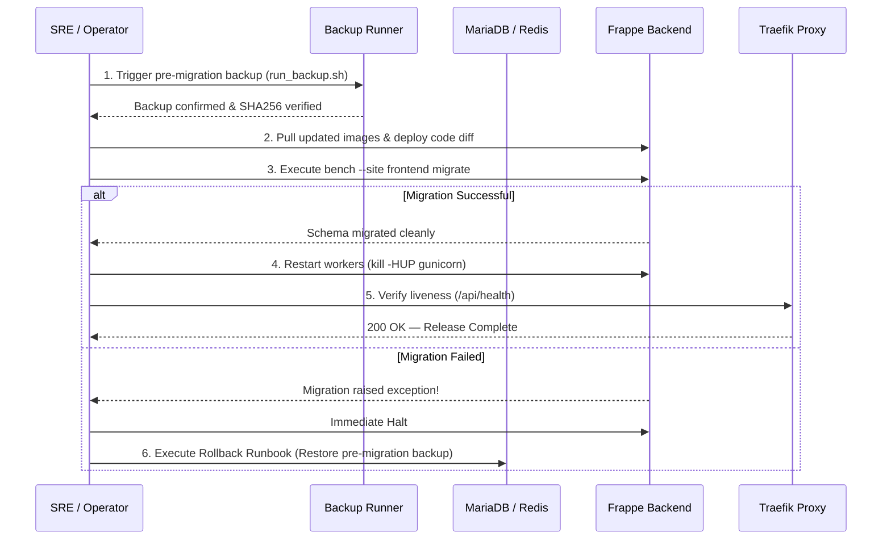

# Staging Deployment and Recovery Runbook

**Document Version:** 1.0 (Phase 15 Staging Readiness)  
**Date:** 2026-10-27  
**Auditor:** Automated Release & SRE Agent  
**Repository:** `sukeshperiyasamy/department-store`  
**Target Infrastructure:** Clean Staging Linux VM / Container Host  
**Edge Ingress Reverse Proxy:** Traefik v3 (`deployment/ingress/`)  
**Backend Application:** ERPNext v16 / Frappe v16 (`deployment/erpnext/pwd.yml`)  
**Manager Console & SaaS Ingress:** Next.js 15 SSR (`apps/owner-dashboard/`)

---

## 1. Executive Summary & Deployment Boundaries

This runbook specifies the step-by-step deployment procedure to provision, configure, validate, update, and recover the Department Store multi-tenant SaaS on a clean staging host.

### Operational Verification Boundaries
```
[Local Dev / Docker Workstation] (VERIFIED)
├── Preflight Configuration Audit: 25 PASSED (Exit code 0)
├── Traefik Dynamic Ingress Validation: PASS
├── Network Isolation & Port Non-Exposure: PASS (MariaDB & Redis ports internal only)
├── Local Scratch Disaster Recovery Rehearsal: PASS (36.6s RTO, 1:1 data parity)
├── Provider-Independent Off-Site Backup Script: PASS (SigV4, AES256, SHA-256)
└── Regression Suite Matrix: 350 Unit/Integration Tests PASS (0 Failed)

[External Staging Infrastructure] (CONDITIONAL / BLOCKED)
├── Public Linux VM Allocation (Static IPv4): BLOCKED (Owner action)
├── Delegated Staging Domain (*.staging.departmentstore.in): BLOCKED (Owner action)
├── Authoritative DNS-01 API Token (Cloudflare/Route53): BLOCKED (Owner action)
└── S3 / Cloudflare R2 Off-Site Bucket Credentials: BLOCKED (Owner action)
```

> [!IMPORTANT]
> Do not attempt live public certificate issuance or public DNS modifications until the Platform Owner has formally provisioned the staging domain and delegated DNS credentials.

---

## 2. Host Operating System & Minimum Resource Requirements

### 2.1 Supported Operating Systems
- **Recommended:** Ubuntu 24.04 LTS (x86_64) or Debian 12 (x86_64)
- **Supported:** AlmaLinux 9 / Rocky Linux 9 (x86_64)
- **Local Development / Testing:** Windows 10/11 (x64) with WSL2 & Docker Desktop

### 2.2 Sizing & Hardware Assumptions

| Resource | Staging Minimum | Production Recommended | Failure Mode Under Stress |
| :--- | :--- | :--- | :--- |
| **CPU** | 4 vCPUs (2.4 GHz+) | 8 vCPUs (3.0 GHz+) | Gunicorn worker request queuing; API latency spikes |
| **RAM** | 12 GB RAM | 32 GB RAM (ECC preferred) | MariaDB / Redis OOM kill; container exit 137 |
| **Swap** | 4 GB NVMe Swapfile | 8 GB NVMe Swapfile | Kernel freeze during peak catalog sync or migrations |
| **Disk Storage**| 80 GB Fast NVMe SSD | 250 GB+ Enterprise NVMe | MariaDB binlog disk exhaustion; backup failure |
| **Network** | 100 Mbps uplink, 1 static IPv4 | 1 Gbps redundant uplink, static IPv4 | Ingress TLS handshake timeouts; POS bill sync lag |

### 2.3 Required Host Software & Version Gates
Prior to deployment, verify that the following tools are installed:
```bash
# Check Docker Engine (Required: >= 26.0.0)
docker --version

# Check Docker Compose (Required: >= 2.26.0)
docker compose version

# Check Git (Required: >= 2.40.0)
git --version

# Check Python 3 (Required: >= 3.11.0)
python3 --version

# Check OpenSSL (Required: >= 3.0.0)
openssl version
```

---

## 3. Environment Inventory & Secret Management

### 3.1 Environment Variable Inventory

| Variable Name | Required Scope | Example Value | Description & Purpose |
| :--- | :--- | :--- | :--- |
| `BASE_DOMAIN` | Traefik / Ingress | `staging.departmentstore.in` | Apex domain for staging environment |
| `ACME_EMAIL` | Traefik TLS | `admin@departmentstore.in` | Let's Encrypt notification address |
| `ACME_RESOLVER` | Traefik TLS | `letsencrypt-staging` | Use staging resolver during setup to avoid rate limits |
| `CF_DNS_API_TOKEN` | Ingress DNS-01 | `<redacted_scoped_token>` | Scoped DNS edit token for wildcard certificate issuance |
| `TRUSTED_PROXY_IPS` | Traefik Ingress | `127.0.0.1,::1,10.0.0.0/8,172.16.0.0/12,192.168.0.0/16` | Trusted upstream CIDRs for client IP resolution |
| `MARIADB_ROOT_PASSWORD` | Backend Database | `<generated_32char_hex>` | Root password for MariaDB container |
| `FRAPPE_ADMIN_PASSWORD` | Backend Frappe | `<generated_32char_hex>` | Administrator password for default site |
| `RAZORPAY_KEY_ID` | Billing Gateway | `rzp_test_stagingKey123` | Razorpay Sandbox Key ID (`rzp_test_` prefix required) |
| `RAZORPAY_KEY_SECRET` | Billing Gateway | `<generated_test_secret>` | Razorpay Sandbox Key Secret |
| `RAZORPAY_WEBHOOK_SECRET`| Billing Webhooks | `<generated_hmac_secret>` | Webhook HMAC-SHA256 signature verification secret |
| `RAZORPAY_LIVE_MODE` | Payment Guard | `false` | Must remain `false` in staging; fails closed if true with test key |
| `OFFSITE_BACKUP_ENABLED` | Backup Script | `false` | Set `true` only when S3/R2 credentials are confirmed |
| `S3_BUCKET_NAME` | Offsite Backup | `department-store-staging-backups` | Cloud object storage bucket name |
| `S3_ACCESS_KEY_ID` | Offsite Backup | `<redacted_key_id>` | IAM / R2 Access Key ID |
| `S3_SECRET_ACCESS_KEY` | Offsite Backup | `<redacted_secret_key>` | IAM / R2 Secret Access Key |
| `S3_REGION_NAME` | Offsite Backup | `ap-south-1` | AWS region or `auto` for Cloudflare R2 |

### 3.2 Secret Creation & Rotation Protocol
1. **Cryptographic Secret Generation:**
   ```bash
   # Generate 32-character random hex strings for passwords and secrets
   openssl rand -hex 32
   ```
2. **File Permissions & Storage:**
   - Store production/staging secrets in `deployment/ingress/.env.staging` and `deployment/erpnext/.env.staging`.
   - Restrict file permissions immediately:
     ```bash
     chmod 600 deployment/ingress/.env.staging
     chmod 600 deployment/erpnext/.env.staging
     ```
   - Never commit `.env.staging` or unmasked secrets to Git.
3. **Secret Rotation Procedure:**
   - Database passwords: rotate using Frappe bench CLI (`bench --site <site> set-mariadb-password`).
   - Webhook secrets: rotate simultaneously in Razorpay Dashboard and server environment variables; reload gunicorn without dropping connections (`docker compose kill -s HUP backend`).

---

## 4. Network Exposure & Port Security Review

To enforce defense-in-depth and comply with `AGENTS.md`:

```
               [Public Internet]
                      │
           ┌──────────┴──────────┐
           │   TCP Ports 80, 443 │
           ▼                     ▼
┌───────────────────────────────────────────────┐
│              Traefik v3 Ingress               │
│             (saas-edge-ingress)               │
└──────────────────────┬────────────────────────┘
                       │
          [Internal Docker Bridge Network]
             (departmental-internal)
                       │
       ┌───────────────┼───────────────┐
       ▼               ▼               ▼
┌──────────────┐┌──────────────┐┌──────────────┐
│ Next.js SSR  ││ Frappe Nginx ││ MariaDB 11.8 │
│  (Port 3100) ││  (Port 8080) ││ (Port 3306)  │
│  [INTERNAL]  ││  [INTERNAL]  ││  [ISOLATED]  │
└──────────────┘└──────────────┘└──────────────┘
                       │
                       ▼
                ┌──────────────┐
                │  Redis Queue │
                │ (Port 6379)  │
                │  [ISOLATED]  │
                └──────────────┘
```

### Verification Rules:
1. `3306:3306` (MariaDB) is **NEVER** exposed on host interfaces.
2. `6379:6379` (Redis) is **NEVER** exposed on host interfaces.
3. `8000:8000` (Gunicorn Python app server) is **NEVER** exposed on host interfaces.
4. Only `80` (HTTP redirect to HTTPS) and `443` (TLS) are published to `0.0.0.0`.
5. All container communications travel through the internal Docker network `departmental-internal`.

---

## 5. Step-by-Step Staging Host Provisioning

### Step 1: System Baseline Setup
```bash
# Update OS packages
sudo apt-get update && sudo apt-get upgrade -y

# Install prerequisite utilities
sudo apt-get install -y curl git jq python3 python3-pip rclone gzip

# Verify Docker installation
docker run --rm hello-world
```

### Step 2: Clone Codebase & Configure Ingress
```bash
# Clone repository
git clone https://github.com/sukeshperiyasamy/department-store.git /opt/department-store
cd /opt/department-store

# Create staging environment file
cp deployment/ingress/.env.example deployment/ingress/.env.staging
# Edit .env.staging with genuine staging domain and ACME email
nano deployment/ingress/.env.staging
```

### Step 3: Validate Compose & Ingress Configurations
```bash
# Validate Ingress Compose configuration
docker compose -f deployment/ingress/docker-compose.traefik.yml --env-file deployment/ingress/.env.staging config

# Run automated preflight audit
node tests/integration/staging_preflight_check.mjs
```

### Step 4: Launch Core Stack & Execute Migrations
```bash
# Start ERPNext backend stack
docker compose -f deployment/erpnext/pwd.yml -p departmental-erp up -d

# Verify container health
docker compose -f deployment/erpnext/pwd.yml -p departmental-erp ps

# Run site migrations and install custom applications
docker exec departmental-erp-backend-1 bench --site frontend migrate
docker exec departmental-erp-backend-1 bench --site frontend install-app departmental_store
docker exec departmental-erp-backend-1 bench --site frontend install-app india_compliance
```

### Step 5: Launch Traefik Ingress
```bash
# Launch Traefik reverse proxy
docker compose -f deployment/ingress/docker-compose.traefik.yml --env-file deployment/ingress/.env.staging up -d

# Verify Traefik logs
docker compose -f deployment/ingress/docker-compose.traefik.yml logs --tail=50 -f
```

### Step 6: Post-Deployment Smoke Test
```bash
# Verify backend liveness endpoint
curl -fsS http://localhost:8080/api/method/departmental_store.api.health.get_liveness

# Verify owner dashboard SSR health
curl -fsS http://localhost:3100/api/health
```

---

## 6. Safe Update Procedure & Failed Migration Rollback

### 6.1 Update Workflow (Zero-Downtime Migration)


### 6.2 Rollback Runbook for Failed Migrations
If a database migration fails during an update:
1. **Stop Application Ingress Immediately:**
   ```bash
   docker compose -f deployment/ingress/docker-compose.traefik.yml stop
   ```
2. **Identify Latest Pre-Migration Backup:**
   ```bash
   LATEST_BACKUP=$(ls -td $HOME/departmental-backups/*/ | head -1)
   echo "Rolling back to: $LATEST_BACKUP"
   ```
3. **Verify Archive Checksums:**
   ```bash
   ( cd "$LATEST_BACKUP" && sha256sum -c SHA256SUMS.txt )
   ```
4. **Restore Database Dump into Production Site:**
   ```bash
   docker cp "$LATEST_BACKUP" departmental-erp-backend-1:/tmp/rollback_dump/
   docker exec departmental-erp-backend-1 bench --site frontend restore /tmp/rollback_dump/*-database.sql.gz --db-root-username root --db-root-password admin
   docker exec departmental-erp-backend-1 rm -rf /tmp/rollback_dump
   ```
5. **Git Checkout Previous Stable Commit:**
   ```bash
   git checkout <PREVIOUS_STABLE_COMMIT_HASH>
   ```
6. **Restart Stack & Ingress:**
   ```bash
   docker compose -f deployment/erpnext/pwd.yml -p departmental-erp restart backend
   docker compose -f deployment/ingress/docker-compose.traefik.yml start
   ```
7. **Verify Site Integrity & Parity:**
   ```bash
   docker exec departmental-erp-backend-1 bench --site frontend execute departmental_store.api.health.get_liveness
   ```
