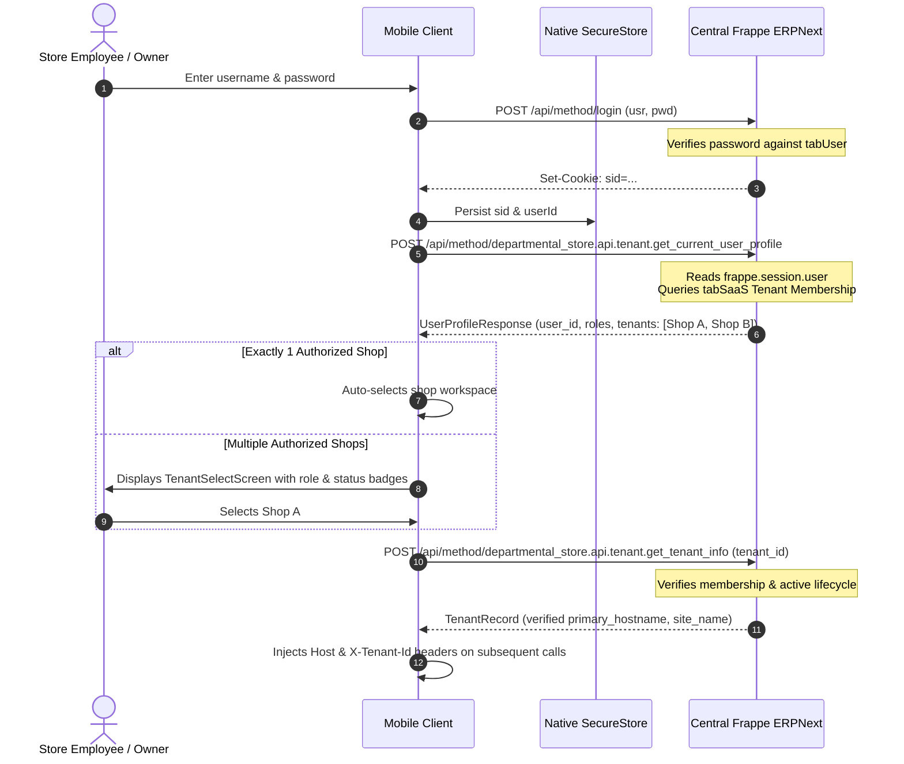

# Shared Multi-Tenant Mobile App Architecture & Testing Guide

## 1. Overview and Objectives

The Departmental Store Mobile App (`@departmental/mobile`) is a shared, cross-platform mobile application supporting multiple independent retail store tenants across Android, iOS, and Web.

Store owners, managers, cashiers, and auditors install the same unified application, authenticate with their ERP credentials, discover the shops they are authorized to access, and interact with features strictly permitted by their server-side roles.

### Core Architectural Principles
1. **Single Unified Mobile Bundle**: A single mobile binary serves all tenants. Tenant identity is never hardcoded.
2. **Authoritative ERP Backend**: Frappe ERPNext is authoritative for financial ledgers, inventory balances, pricing lists, and tenant registries.
3. **Strict Server-Side Isolation**: Membership and role permissions are enforced server-side. The mobile app never relies on client-side button hiding alone.
4. **No Conflicting Mobile Billing Engine**: The Windows POS (Tauri + React + SQLite) remains authoritative for checkout counter transactions. The mobile app operates in verified inspection, overview, catalog discovery, and operational review mode.
5. **Zero Secret Leakage**: No private keys, database passwords, or administrative tokens are bundled in client assets.

---

## 2. Architecture & Technology Stack

| Component | Technology | Rationale |
|---|---|---|
| **Framework** | Expo SDK 52 + React Native 0.76.6 | Cross-platform (Android, iOS, Web) with standardized native modules |
| **Language** | TypeScript 5.6 (Strict Mode) | Type safety across API payloads and component contracts |
| **Shared Contracts** | `@departmental/shared-types` (Zod) | Single source of truth shared with Windows POS, Owner Dashboard, and Frappe |
| **Secure Storage** | `expo-secure-store` | iOS Keychain / Android KeyStore with in-memory fallback for testing & web |
| **Caching Engine** | Tenant-Scoped Read Cache (`TenantCacheManager`) | Per-tenant offline inspection with explicit `isStale` / `cachedAt` flags |
| **Design System** | Custom Light Theme | White surfaces (`#ffffff`), soft-grey canvas (`#f8fafc`), teal accents (`#0d9488`) |

---

## 3. Authentication & Tenant Discovery Flow



---

## 4. Tenant Isolation & Cache Invalidation Boundary

To prevent cross-tenant data leakage:
1. **Per-Tenant Cache Scoping**:
   All persisted cache entries use composite keys:
   ```typescript
   cacheKey = `${userId}:${tenantId}:${subKey}`;
   ```
2. **Purge on Tenant Switch**:
   When a user switches from Shop A to Shop B, `api.setActiveTenant(tenantB)` executes `tenantCache.clearTenant(tenantA.tenant_id)`, immediately destroying Shop A's cached KPIs and sales in memory.
3. **Suspended Tenant Denial**:
   If a tenant's `lifecycle_status` or user's `membership_status` is `SUSPENDED`, the shop selector displays `Suspended 🔒` and refuses navigation. Backend endpoints raise `PermissionError` if an old or forged token is presented.
4. **Logout Purge**:
   Logging out destroys the session cookie via `POST /api/method/logout`, deletes `STORAGE_KEYS` from native `SecureStore`, and calls `tenantCache.clearAll()`.

---

## 5. Screen Breakdown & Verified Capabilities

### A. Authentication & Onboarding
- **`SplashScreen.tsx`**: Restores existing session credentials from hardware keystore, tests backend connectivity, and routes seamlessly.
- **`SignInScreen.tsx`**: Username & password input with configurable server endpoint (for local dev, staging, or production ingress).
- **`TenantSelectScreen.tsx`**: Displays all shops the user is authorized to access, with distinct role chips (`Owner`, `Manager`, `Cashier`) and status badges (`ACTIVE` vs `SUSPENDED`).

### B. Store Overview (`StoreOverviewScreen.tsx`)
- **Prominent Tenant Banner**: Displays active shop name, slug, and role at the top of every screen.
- **Role-Appropriate Cards**:
  - *Store Owners & Managers*: Today's Gross Sales, Bills Count, Net Sales (pre-GST), Average Bill Value, Taxes Collected (GST), Returns Total, and Payment Modes breakdown.
  - *Cashiers*: Operational status cards confirming counter connectivity and shift status without exposing unauthorized financial reports.
- **Stale Data Notice**: Clear yellow banner indicating when data is loaded from offline cache (`⚠️ Viewing cached offline data`).
- **Pull to Refresh**: Seamless manual reload via native `RefreshControl`.

### C. Catalog & Inventory (`CatalogScreen.tsx`)
- **Multi-Field Product Search**: Searches by Item Code, Item Name, Barcode, Tanglish/Tamil aliases, and Brand.
- **Authoritative Price List**: Displays accurate selling prices (`price_list_rate`) directly from the server price list.
- **Stock Guard**: Informs users that stock adjustments must be processed via authorized ERP Stock Entry workflows; cashiers operate in verified read-only inspection mode.

### D. Sales & Operational Activity (`SalesActivityScreen.tsx`)
- **Live Invoices Feed**: Real-time list of submitted ERPNext sales invoices (`ACC-SINV-...`).
- **Status Badges**: Distinguishes `CONFIRMED` sales, `RETURN` credit notes, and `REQUIRES_REVIEW` holds.
- **Immutable Financial Ledger**: Explains ERPNext posting status (GL and SLE posted); no client-invented transaction states.

### E. Settings & Diagnostics (`SettingsScreen.tsx`)
- **User & Shop Context**: Displays user email, roles, active tenant ID, and hostname.
- **Live Health Diagnostics**: Performs real-time ping against `departmental_store.api.reports.server_status` to report Frappe and MariaDB engine health.
- **Shop Switcher**: Instant transition back to `TenantSelectScreen` for multi-shop managers.
- **Logout Action**: Completely purges session credentials.

---

## 6. Development & Testing Commands

### Unit & Typecheck Verification
```powershell
# Typecheck mobile workspace
npm run typecheck --workspace @departmental/mobile

# Run mobile security & isolation unit tests
npm run test --workspace @departmental/mobile

# Run typecheck across entire monorepo
npm run typecheck

# Run all unit tests across all workspaces (mobile, POS, dashboard, shared-types)
npm run test
```

### Live ERP Integration Verification
```powershell
# Verify mobile login, tenant discovery, and isolation against live Docker ERP
node tests/integration/mobile_discovery_check.mjs

# Run Frappe backend tenant API tests
docker exec departmental-erp-backend-1 bench --site frontend run-tests --module departmental_store.tests.test_tenant_api
```

### Starting the Expo Development Server
```powershell
# Start Expo bundler
cd apps/mobile
npx expo start

# Start for Web preview
npx expo start --web

# Start for Android emulator / connected device
npx expo start --android

# Start for iOS simulator (macOS required)
npx expo start --ios
```

---

## 7. Supported Platforms & Build Requirements

| Platform | Support Status | Prerequisites & Build Tooling |
|---|:---:|---|
| **Web** | ✅ Supported | Chrome / Edge / Safari via `npx expo start --web` |
| **Android** | ✅ Supported | Android SDK 34+, Java 17+, Android Studio or EAS Build (`npx eas build -p android`) |
| **iOS** | 🟡 Documented | Requires macOS host with Xcode 15+ and Apple Developer signing credentials |

---

## 8. Staging & Production Deployment Gate

- **Development Status**: **`DEVELOPMENT COMPLETE`**
- **Production Gate**: Do **not** deploy production mobile builds to Google Play or Apple App Store until Phase 4C staging acceptance passes with a real public domain, wildcard TLS certificates, and live physical device verification.
