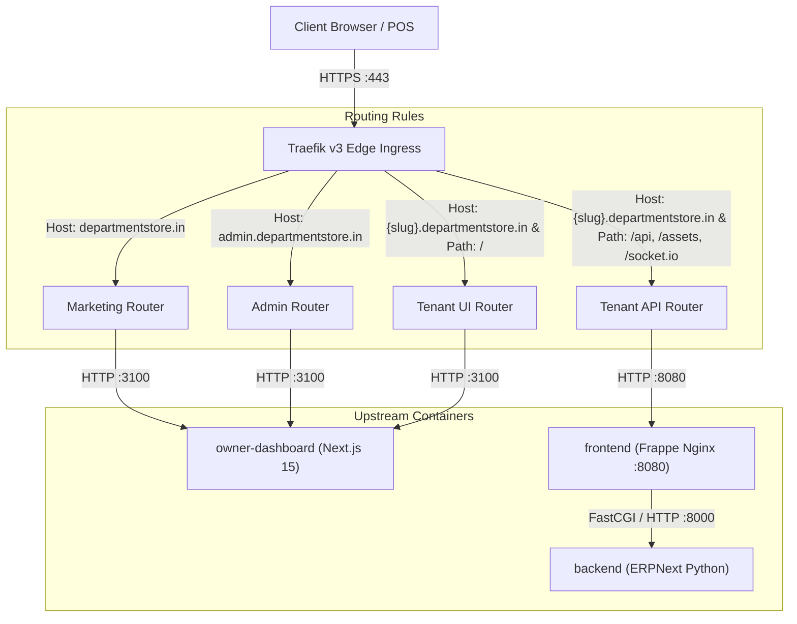

# Production Ingress, Wildcard TLS, and Domain Verification Guide

This guide defines the production and staging ingress architecture for the Departmental Store SaaS platform using **Traefik v3**, automated Let's Encrypt wildcard TLS via DNS-01 challenge, safe tenant subdomain routing, and strict upstream isolation.

---

## 1. Domain and DNS Architecture

The platform architecture organizes traffic across three classes of hostnames over a configurable base domain (e.g., `${BASE_DOMAIN}`, default placeholder: `departmentstore.in`):

| Hostname Pattern | Audience | Target Upstream | Handled By |
| :--- | :--- | :--- | :--- |
| `departmentstore.in` (Apex) | Public / Customers | Next.js SSR (`owner-dashboard:3100`) | Marketing Homepage, Pricing, Features, Onboarding |
| `www.departmentstore.in` | Public / Customers | Next.js SSR (`owner-dashboard:3100`) | Canonical redirect or marketing mirror |
| `admin.departmentstore.in` | Platform Operators | Next.js SSR (`owner-dashboard:3100`) + Frappe APIs | Platform Admin Console (`/admin/onboarding`) |
| `*.departmentstore.in` (e.g. `shop-a`) | Store Owners / Staff | Dual Upstream (Next.js + Frappe Nginx) | Store Management UI + POS Sync & REST APIs |

### Authoritative DNS Record Configuration

Configure the following records in your authoritative DNS manager (Cloudflare, AWS Route53, etc.):

```dns
; 1. Root / Apex Domain (A / AAAA Record or CNAME Flattening)
@                   300     IN      A       203.0.113.10          ; Public Server Ingress IPv4
@                   300     IN      AAAA    2001:db8::10          ; Public Server Ingress IPv6 (optional)

; 2. WWW Subdomain (CNAME)
www                 300     IN      CNAME   @

; 3. Platform Administration Subdomain
admin               300     IN      CNAME   @

; 4. Wildcard Tenant Subdomains (Matches shop-a, shop-b, etc.)
*                   300     IN      CNAME   @
```

> [!IMPORTANT]
> **Cloudflare Proxy Warning**: If using Cloudflare DNS, set the wildcard record `*` to **DNS Only (Grey Cloud)** during initial certificate provisioning, or ensure your Cloudflare account supports Cloudflare for SaaS. For direct Let's Encrypt ACME DNS-01 issuance, Traefik needs API access to write TXT records to `_acme-challenge.departmentstore.in`.

---

## 2. ACME Wildcard TLS via DNS-01 Challenge

Per ACME RFC 8555, wildcard certificates (`*.departmentstore.in`) **CANNOT** be issued via standard HTTP-01 challenges. They strictly require the **DNS-01 challenge**.

### How DNS-01 Challenge Works
1. Traefik connects to Let's Encrypt ACME directory (`acme-v02.api.letsencrypt.org`).
2. Let's Encrypt provides a cryptographic token.
3. Traefik automatically creates a DNS `TXT` record at `_acme-challenge.departmentstore.in` via the DNS provider API.
4. Let's Encrypt validates the TXT record against authoritative name servers (`1.1.1.1`, `8.8.8.8`).
5. Let's Encrypt issues the certificate covering both `departmentstore.in` and `*.departmentstore.in`.
6. Traefik automatically cleans up the temporary `TXT` record and saves the certificate to `acme.json`.

### Supported DNS Providers (Lego Integration)
Traefik v3 natively embeds Lego and supports:
- **Cloudflare**: requires `CF_DNS_API_TOKEN` (permissions: `Zone:DNS:Edit` for the zone).
- **AWS Route53**: requires `AWS_ACCESS_KEY_ID`, `AWS_SECRET_ACCESS_KEY`, `AWS_REGION`, `AWS_HOSTED_ZONE_ID`.
- **DigitalOcean**: requires `DO_AUTH_TOKEN`.
- **Google Cloud DNS**: requires `GCE_PROJECT`, `GCE_SERVICE_ACCOUNT_FILE`.

### Persistent ACME State & File Permissions
The ACME state file `/etc/traefik/acme/acme.json` holds private keys and must be securely stored.
- On the host filesystem, ensure permissions are strictly **`0600`** (`chmod 600 acme.json`).
- If permissions are too open, Traefik will refuse to load or write to the file for security reasons.

---

## 3. Dual-Upstream Request Flow

Traffic hitting Traefik on port 443 is split between the Next.js application and the Frappe Nginx container:



### Path-Based Upstream Partitioning for Tenant Subdomains
For any tenant subdomain (e.g., `shop-a.departmentstore.in`):
1. **API & Static Requests** (`/api/*`, `/assets/*`, `/socket.io/*`, `/files/*`):
   - Handled directly by `frappe-frontend-service` (`frontend:8080`).
   - `Host` header is preserved: Frappe's Nginx sets `X-Frappe-Site-Name: shop-a.departmentstore.in`.
   - POS billing counters sync via `/api/method/departmental_store.api.sales.submit_pos_sale`.
2. **Management & Dashboard UI** (`/`, `/app/*`, `/settings/*`, `/inventory/*`, `/catalog/*`):
   - Handled by `owner-dashboard-service` (`owner-dashboard:3100`).
   - Next.js middleware extracts `x-tenant-slug`, verifies tenant status in Frappe MariaDB registry, sets cache isolation headers (`Vary: Host, Cookie`), and prevents `/admin` access.

---

## 4. Security, Headers & Cache Partitioning

### A. Untrusted Header Stripping
Clients can forge headers such as `X-Forwarded-For`, `X-Forwarded-Host`, and `X-Forwarded-Proto`.
- Traefik entry points specify `forwardedHeaders.trustedIPs`. Only requests originating from those trusted CIDRs have their forwarding headers honored.
- For untrusted clients, Traefik discards existing forwarding headers and replaces them with the actual TCP remote address and incoming host.
- The downstream Next.js middleware inspects `TRUSTED_PROXY_IPS` and ignores client-supplied `x-forwarded-host` unless from a trusted proxy.

### B. Cross-Tenant Cache Isolation
To prevent shared CDNs, reverse proxies, or browser caches from serving Shop A's cached HTML to Shop B:
- Ingress sets `Vary: Host, Cookie` on all tenant routes.
- Sensitive dashboard pages return `Cache-Control: no-cache, no-store, must-revalidate`.

### C. Cookie Scope Hardening
- Cookies set by tenant dashboards must **omit** `Domain=.departmentstore.in` so they are **Host-Only** cookies (`shop-a.departmentstore.in` cannot read cookies of `shop-b.departmentstore.in`).
- Cookies must carry `Secure; HttpOnly; SameSite=Lax`.

### D. HSTS Rollout Considerations
- Production specifies `Strict-Transport-Security: max-age=31536000; includeSubDomains; preload`.
- **Pre-flight Warning**: Do NOT enable HSTS `preload` or 1-year `max-age` during early testing. Use `max-age=300` in staging, and increase to `31536000` only after all subdomains and wildcard certificates are fully proven.

---

## 5. Deployment Environments Comparison

| Configuration Parameter | Local Development | Staging Environment | Production Environment |
| :--- | :--- | :--- | :--- |
| **Base Domain** | `localhost` | `staging.departmentstore.in` | `departmentstore.in` |
| **TLS Certificates** | Self-signed or plain HTTP | Let's Encrypt Staging (`letsencrypt-staging`) | Let's Encrypt Production (`letsencrypt-prod`) |
| **ACME Rate Limits** | None | 30,000 certs/week | 50 certs/week (Strict) |
| **HSTS Duration** | Disabled | `max-age=300` | `max-age=31536000; includeSubDomains` |
| **DNS-01 Provider** | None (Local `/etc/hosts`) | Cloudflare API Token (Test Zone) | Cloudflare API Token (Production Zone) |
| **Public Ports Exposed** | `8080` (Frappe), `3100` (Next.js) | `80`, `443` ONLY | `80`, `443` ONLY |
| **Internal DB / Redis Ports** | Accessible on loopback | **BLOCKED** from public | **BLOCKED** from public |

---

## 6. Certificate Renewal Monitoring & Incident Recovery

### Automatic Renewal
Traefik checks certificate expiry continuously. When a certificate is within 30 days of expiration, Traefik automatically triggers a renewal via DNS-01.

### Renewal Failure Alerts & Monitoring
1. **Health Check Endpoint**: `GET http://127.0.0.1:8080/ping` verifies Traefik's internal engine.
2. **Prometheus Metrics**: `GET http://127.0.0.1:8080/metrics` exports `traefik_tls_certs_not_after_timestamp`. Configure Prometheus Alertmanager:
   ```yaml
   - alert: TraefikTLSCertExpiringSoon
     expr: (traefik_tls_certs_not_after_timestamp - time()) / 86400 < 14
     for: 1h
     labels:
       severity: warning
     annotations:
       summary: "Wildcard TLS certificate expires in under 14 days"
   ```
3. **Manual Certificate Force-Renewal**:
   If a certificate is corrupted or renewal fails:
   ```bash
   # 1. Stop ingress
   docker compose -f deployment/ingress/docker-compose.traefik.yml stop traefik
   # 2. Inspect/backup current acme.json
   cp /var/lib/docker/volumes/saas-traefik-acme-data/_data/acme.json /tmp/acme.backup.json
   # 3. Remove corrupt entry and restart
   docker compose -f deployment/ingress/docker-compose.traefik.yml start traefik
   # 4. Follow logs to observe DNS-01 challenge
   docker compose -f deployment/ingress/docker-compose.traefik.yml logs -f traefik
   ```
