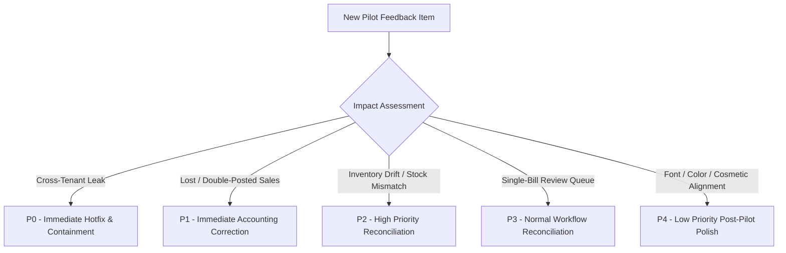

# Customer Feedback & Issue Tracking Workflow

**Milestone:** Phase 9 — Controlled Pilot Launch and Real-Shop Validation  
**Scope:** Pilot Shops (1–3 Cohort) and Test Tenants  
**Author:** Antigravity Release Engineering Agent  

---

## 1. Objective & Purpose

During the controlled pilot, feedback and defects from participating shop owners, counter cashiers, and store managers must be collected through a structured intake process. The workflow guarantees that critical defects (data isolation leaks, sales losses, double charges, inventory divergence, or accounting imbalances) receive immediate remediation, while strictly forbidding the collection of confidential data (passwords, PINs, card CVVs, or unnecessary customer personal details).

---

## 2. Structured Pilot Feedback Schema

When an issue or suggestion is reported by a pilot store owner or observed by an operator, the following intake record must be completed:

```markdown
### Pilot Incident / Feedback Ticket: [PILOT-ISSUE-YYYYMMDD-XXX]

- **Tenant Identifier:** `shop-a.departmentstore.in` (or local slug `pilot-shop-01`)
- **Date & Time Reported:** 2026-10-27 11:00 IST
- **Reporter Role:** [ ] Store Owner  [ ] Cashier  [ ] Manager  [ ] Platform Operator
- **Application & Version:**
  - [ ] Windows POS Desktop (v0.1.0)
  - [ ] Store Owner Web Dashboard (Next.js 16)
  - [ ] Shared Mobile App (React Native)
  - [ ] Central SaaS Platform / Ingress
- **Correlation / Transaction ID:** `TXN-20261027-XXXXXXXX` (if applicable)

---

#### 1. Attempted Action
What specific task was the user attempting to accomplish?
*(e.g., "Scan barcode for Parle-G, tender cash payment of 500 INR, and issue receipt.")*

#### 2. Expected Behavior
What was supposed to happen according to business specifications?
*(e.g., "Bill completes locally, prints thermal receipt with 480 INR change, and queues outbox event for sync.")*

#### 3. Actual Behavior
What actually happened? Include exact on-screen error banners or UI states.
*(e.g., "Counter shows 'Requires Review: PAYMENT_SHORTFALL' and bill is held.")*

#### 4. Severity & Business Impact
- [ ] **Severity 1 (Critical):** Cross-tenant data exposure, corrupted accounting ledger, or complete counter billing halt with no offline fallback.
- [ ] **Severity 2 (High):** Inventory synchronization stuck, multiple duplicate bills posted, or hardware peripheral failure.
- [ ] **Severity 3 (Medium):** Isolated bill placed in review queue; temporary UI sluggishness; single-user login issue with workaround.
- [ ] **Severity 4 (Low / Cosmetic):** Layout alignment, minor visual styling, non-blocking feature request.

#### 5. Financial & Stock Impact
- **Are Finalized Sales Affected?** [ ] Yes  [ ] No
- **Is Stock Inventory Discrepant?** [ ] Yes  [ ] No
- **Are GST / Tax Ledgers Discrepant?** [ ] Yes  [ ] No

#### 6. Reproduction Steps
1. ...
2. ...
3. ...

#### 7. Sanitized Diagnostic Context
- Log snippet from `%APPDATA%\DepartmentStorePOS\logs\sync.log` or browser console.
- **Redaction Check:** Verified NO passwords, UPI MPINs, card numbers, or customer addresses are present.

---

#### 8. Resolution & Verification Status
- **Status:** [ ] Open  [ ] In Triage  [ ] Fix Implemented  [ ] Verified on Staging  [ ] Closed
- **Assigned Engineer:** ...
- **Fix Commit / Pull Request:** ...
- **Verification Signature:** ...
```

---

## 3. Strict Privacy & Data Protection Rules

To comply with data privacy policies and PCI/GST safety standards:
1. **Never Collect Secrets:** Passwords, API secret keys, device bearer tokens, payment gateway webhook secrets, and private SSL keys must never be entered into feedback forms or ticket trackers.
2. **Never Collect Card / UPI Credentials:** Credit/debit card PANs, CVVs, expiry dates, and UPI PINs are strictly prohibited. Only authorized payment transaction reference IDs (e.g. `pay_XXXXXXXXXX`) may be recorded for reconciliation.
3. **Redact Customer Personal Data:** Do not capture customer phone directories or home addresses unless specifically investigating an authorized localized SMS delivery defect (and even then, sanitize phone numbers: `+91 98401 *****`).

---

## 4. Triage & Prioritization Hierarchy

Issues are prioritized based on business and financial integrity rather than aesthetic polish:



| Priority | Category | Examples | Target Resolution Time |
|---|---|---|---|
| **P0** | Security & Isolation | Tenant A seeing Tenant B orders or reports; unauthorized role escalation. | < 2 Hours (Emergency freeze) |
| **P1** | Financial Integrity | Double billing, duplicate invoices, failed ERPNext GL reconciliation, lost cash receipts. | < 4 Hours |
| **P2** | Inventory Integrity | Stock ledger entry missing on return, negative physical stock without override flag. | Same Business Day |
| **P3** | Operational Flaws | Slow barcode scan response, printer margin cut offset, non-blocking sync lag. | Within 48 Hours |
| **P4** | Cosmetic / Enhancements | Button padding, color gradient adjustments, icon spacing. | Post-Pilot Milestone |
