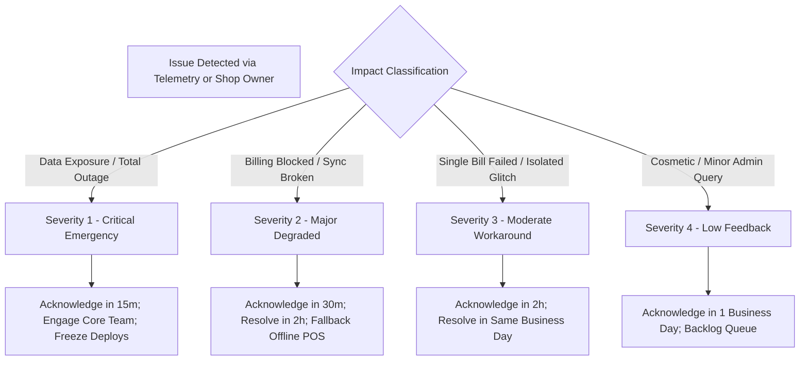

# Pilot Monitoring and Escalation Guide

**Milestone:** Phase 9 — Controlled Pilot Launch and Real-Shop Validation  
**Target Environment:** Local Staging / Pilot Cluster (1–3 Shops)  
**Author:** Antigravity Release Engineering Agent  

---

## 1. Operational Telemetry & Cockpit Overview

During the controlled pilot, system stability, tenant isolation, and transaction fidelity are continuously monitored through two primary mechanisms:
1. **Pilot Operational Endpoint (`get_pilot_status`):** Built-in Frappe method providing authenticated platform operators with a consolidated snapshot of multi-tenant health, synchronization queues, and database metrics.
2. **Next.js & POS Telemetry:** Dashboard health probes and local SQLite sync queue metrics.

### Live Telemetry Query

Platform operators can retrieve the operational status at any time:

```bash
# Authenticated platform operator status probe
curl -s -b "sid=<operator_session_cookie>" \
  http://localhost:8080/api/method/departmental_store.api.health.get_pilot_status
```

Example payload response:
```json
{
  "api_version": 1,
  "timestamp": "2026-10-27T10:59:34.120Z",
  "pilot_tenants": {
    "total": 5,
    "active": 3,
    "suspended": 1,
    "provisioning": 0,
    "verification_pending": 1
  },
  "provisioning_jobs": {
    "in_flight": 0,
    "failed_last_24h": 0,
    "stale_jobs": 0
  },
  "pos_sync": {
    "pending_sync_events": 0,
    "requires_review_backlog": 1,
    "server_committed_today": 258,
    "duplicate_retries_prevented_today": 14
  },
  "system_health": {
    "status": "HEALTHY",
    "database_latency_ms": 0.06,
    "disk_usage_percent": 42.1,
    "redis_queue_depth": 0,
    "last_backup_verified": "2026-10-27 10:22:47"
  },
  "escalation_thresholds": {
    "db_latency_warning_ms": 250,
    "db_latency_critical_ms": 1000,
    "sync_backlog_warning": 20,
    "sync_backlog_critical": 50,
    "disk_warning_percent": 80,
    "disk_critical_percent": 90
  }
}
```

---

## 2. Monitored Operational Dimensions

| Dimension | Telemetry Source | Safe Baseline | Warning Level | Critical Action Level |
|---|---|---|---|---|
| **API & DB Latency** | `get_pilot_status` / MariaDB ping | < 50ms | > 250ms for 5m | > 1000ms -> Alert on-call |
| **POS Sync Backlog** | SQLite `outbox_events` / `POS Sale Sync Log` | 0–5 events | > 20 events uncommitted | > 50 events -> Investigate counter network |
| **Requires Review Queue** | `tabPOS Sale Sync Log` status | 0 bills | > 3 bills requiring review | > 10 bills -> Dispatch manager review |
| **Provisioning Worker** | `tabSaaS Provisioning Job` | 0 pending | 1 job stuck > 10m | Job failed with retry exhausted (3) |
| **Disk Storage** | Host root volume `/` & Docker volume | < 60% | > 80% usage | > 90% -> Run log rotation & scratch cleanup |
| **Backup Parity** | `C:\DepartmentStoreBackups\daily` | Daily verified | Missing at 04:00 | Restore verification failure |
| **TLS Expiry** | Traefik / ACME cert status | > 30 days valid | < 14 days valid | Expired -> Immediate fallback/renewal |

---

## 3. Incident Severity & Escalation Matrix



### Escalation Runbook Links
- **Database Latency / Connection Exhaustion:** Refer to [RUNBOOK-04: Database High Latency and Connection Exhaustion](file:///c:/Users/COMPUTER/Downloads/sukesh/departmental/docs/operations/INCIDENT_RESPONSE_RUNBOOKS.md#runbook-04-database-high-latency-and-connection-exhaustion).
- **POS Synchronization Failure / Deadlocks:** Refer to [RUNBOOK-01: POS Counter Network Outage and Offline Desynchronization](file:///c:/Users/COMPUTER/Downloads/sukesh/departmental/docs/operations/INCIDENT_RESPONSE_RUNBOOKS.md#runbook-01-pos-counter-network-outage-and-offline-desynchronization).
- **Tenant Provisioning Failure:** Refer to [RUNBOOK-05: Provisioning Job Stall and Worker Crash](file:///c:/Users/COMPUTER/Downloads/sukesh/departmental/docs/operations/INCIDENT_RESPONSE_RUNBOOKS.md#runbook-05-provisioning-job-stall-and-worker-crash).
- **Tenant Isolation Breach:** Refer to [RUNBOOK-10: Tenant Security Boundary and Data Isolation Incident](file:///c:/Users/COMPUTER/Downloads/sukesh/departmental/docs/operations/INCIDENT_RESPONSE_RUNBOOKS.md#runbook-10-tenant-security-boundary-and-data-isolation-incident).

---

## 4. Privacy & Authorization Guardrails

1. **Least Privilege Operators:** Standard store managers or cashiers cannot query the global telemetry endpoint; `@frappe.only_for("Platform Admin")` is enforced at the controller level.
2. **Zero PII Exposure in Metrics:** Telemetry endpoints report aggregate counts, latencies, and sanitized identifiers. Customer names, phone numbers, and payment credentials are never exposed in log output or operational dashboards.
3. **Audit Trail:** Every status adjustment, tenant suspension, or manual retry logs an immutable record into `tabSaaS Provisioning Audit Log` with `actor`, `timestamp`, and `reason`.
