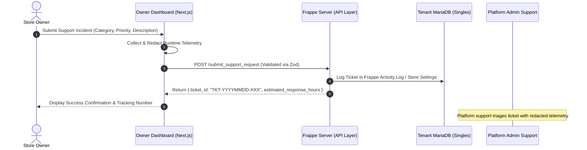

# Customer Support Workflows & Self-Service Diagnostics

## 1. Objectives & Overview
Independent retail store owners need immediate, non-technical paths to resolve daily billing interruptions, understand synchronization status across multiple counters, and request assistance from platform engineers without exposing passwords, customer personal details, or sensitive supplier pricing.

---

## 2. In-App Support Request Architecture

### Data Flow & Execution


### Supported Categories & SLA Targets

| Category | Description | Severity / SLA | Escalation Trigger |
| :--- | :--- | :--- | :--- |
| **`POS_SYNC`** | Billing counter transactions failing to sync to central ERPNext | High (4 hrs) / Urgent (1 hr if all counters stalled) | > 5 uncommitted bills in review queue |
| **`HARDWARE_PRINTER`** | ESC/POS thermal printer or barcode label sticker printer malfunction | Normal (8 hrs) | Driver or baud-rate mismatch |
| **`INVENTORY`** | Stock discrepancy, negative batch quantities, or missing barcode items | Normal (12 hrs) | Missing FIFO batch record |
| **`BILLING`** | GST tax percentage calculation discrepancy or receipt layout adjustment | High (6 hrs) | Inter-state IGST vs Intra-state CGST/SGST mismatch |
| **`ACCOUNT`** | Store manager password reset, cashier PIN recovery, or role assignment | High (4 hrs) | Lockout of primary store manager |
| **`OTHER`** | Feature requests, UI suggestions, or general questions | Low (24 hrs) | Standard backlog review |

---

## 3. Safe Diagnostic Bundle Specification

When a store owner copies or transmits system diagnostics, sensitive data is stripped before serialization:

### Redacted Diagnostic Bundle Schema
```json
{
  "timestamp": "2026-10-27T10:30:00.000Z",
  "store_name": "Sri Murugan Departmental Store",
  "gstin": "33AAAAA0000A1Z5",
  "timezone": "Asia/Kolkata",
  "counters": [
    {
      "id": "pos-counter-01",
      "name": "Billing Counter 1",
      "last_sync": "2026-10-27T10:28:15.000Z",
      "status": "Enabled"
    },
    {
      "id": "pos-counter-02",
      "name": "Billing Counter 2",
      "last_sync": "2026-10-27T10:15:00.000Z",
      "status": "Enabled"
    }
  ],
  "database": {
    "engine": "MariaDB",
    "version": "11.8.9-MariaDB-ubu2404",
    "innodb_deadlocks": 0
  },
  "frappe_version": "Frappe v16.53.0 / ERPNext v16.52.1",
  "active_flags": {
    "regional_catalog_enabled": true,
    "receipt_printing_enabled": true,
    "barcode_label_printing_enabled": true,
    "batch_expiry_enabled": true,
    "expiry_notifications_enabled": true
  }
}
```

### Explicit Redaction Rules
- **No Passwords or Tokens:** Never includes Frappe session cookies (`sid`), API secrets, or database root passwords.
- **No Customer PII:** Customer mobile numbers, loyalty balances, or personal addresses are completely omitted.
- **No Cross-Tenant Data:** Tenant queries are scoped strictly to the authenticated tenant site.
- **No Financial Secrets:** Banking details, razorpay keys, or gross revenue aggregates are excluded.

---

## 4. Retail Store Owner Self-Service Troubleshooting Runbook

### Issue A: "Counter says OFFLINE and bills are not syncing"
1. **Check Local Network:** Ensure counter PC is connected to the store's local Wi-Fi or Ethernet switch.
2. **Inspect POS Status Bar:** Look at the bottom status pill in Windows POS. If it shows `OFFLINE (X bills pending)`, bills are safely recorded in SQLite and sales will not be lost.
3. **Verify ERP Server Container:** Open `Dashboard -> Settings -> System Health`. If MariaDB and Frappe show green, the backend is active.
4. **Trigger Manual Sync:** In Windows POS, press `F5` or click "Sync Now". If the error persists, open `Settings -> 10. Customer Support & Diagnostics` and submit a ticket with category `POS_SYNC`.

### Issue B: "Thermal printer prints gibberish or does not cut"
1. **Check Printer Baud Rate:** Ensure the thermal printer (e.g. TVS / EPSON TM-T82) baud rate matches the POS device configuration (typically 9600 or 115200 baud).
2. **Paper Roll Check:** Verify 80mm thermal paper is loaded face up.
3. **Receipt Preview:** Check `Settings -> Receipt & Label Printers -> Receipt Preview` to verify that header, footer, and items render correctly before testing hardware.

### Issue C: "Item not recognized during barcode scan"
1. **Check Barcode Whitespace:** Physical scanners occasionally insert a trailing carriage return. Ensure the scanner is configured in "HID Keyboard Mode" with Enter suffix.
2. **Check Catalog Sync:** Open `Dashboard -> Catalog` and search the barcode digits. If the item is missing, add it to ERPNext Item master and trigger "Refresh Snapshot" in Windows POS (`Ctrl+R`).
