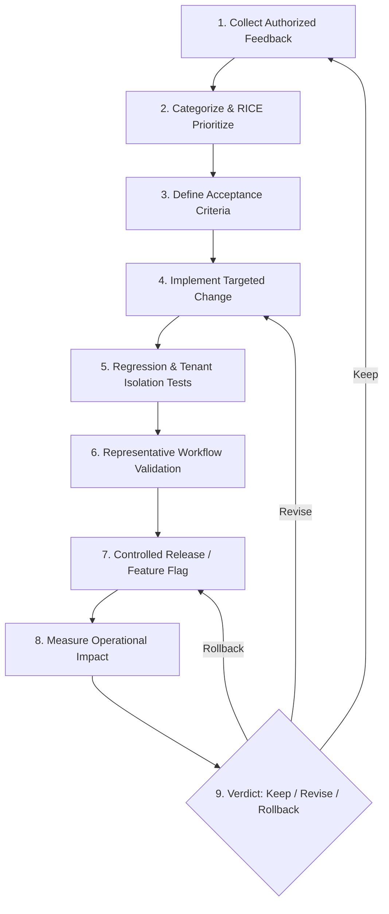

# Standard Operating Procedure (SOP): Product Feedback & Release Loop

## 1. Purpose & Guiding Principles
This SOP establishes a disciplined, evidence-based cycle for evolving the Departmental Store SaaS. Every engineering modification must originate from verified pilot feedback or statutory retail requirements, be verified with automated regression suites, and preserve tenant isolation and ERPNext business workflows.

---

## 2. The 9-Stage Repeatable Feedback Cycle



---

## 3. Detailed Stage Instructions

### Stage 1: Collect Authorized Feedback
- **Source:** Pilot store participants, cashiers, and store managers via:
  - In-app support tickets (`/settings -> 10. Customer Support & Diagnostics`).
  - Weekly structured discovery interviews (using the 8-dimension schema in [`CUSTOMER_FEEDBACK_AND_DISCOVERY_FRAMEWORK.md`](file:///c:/Users/COMPUTER/Downloads/sukesh/departmental/docs/product/CUSTOMER_FEEDBACK_AND_DISCOVERY_FRAMEWORK.md)).
- **Rule:** Never collect raw customer contact numbers or payment card details.

### Stage 2: Categorize & RICE Prioritize
- Score requests using the RICE + Risk model in [`COMMERCIAL_FEATURE_EVALUATION.md`](file:///c:/Users/COMPUTER/Downloads/sukesh/departmental/docs/product/COMMERCIAL_FEATURE_EVALUATION.md).
- Classify into:
  - *Confirmed Customer Problem* (Immediate sprint priority).
  - *Observed Usability Issue* (Refinement backlog).
  - *Technical Reliability Gap* (Hardening task).
  - *Business Opportunity* (Discovery required).
  - *Speculative Idea* (Deferred).

### Stage 3: Define Measurable Acceptance Criteria
- Every ticket must define testable assertions before code is written:
  - *Example:* "Store owner can export all items with `actual_qty <= reorder_level` as a CSV file in < 2 clicks."
  - *Example:* "Windows POS strips leading/trailing scanner whitespace without throwing `ITEM_NOT_FOUND`."

### Stage 4: Implement Targeted Changes
- Follow least-privilege architecture:
  - TypeScript strict mode for frontend and shared contracts.
  - ERPNext DocType methods for authoritative business operations.
  - Zero direct SQL table mutations.
  - Avoid broad architectural rewrites when a targeted component solves the problem.

### Stage 5: Regression & Tenant Isolation Tests
- **Mandatory Suite Execution:**
  ```powershell
  # 1. Shared Types & Unit Tests
  npm test
  
  # 2. Strict Typecheck
  npm run typecheck
  
  # 3. Authoritative Frappe Backend API Tests
  docker exec -i departmental-erp-backend-1 bench --site frontend run-tests --app departmental_store
  
  # 4. Release Simulation Suite
  node tests/integration/release_simulation_suite.mjs
  ```
- **Tenant Isolation Check:** Confirm `site_<tenant_a>` cannot view or modify `site_<tenant_b>` store profile or support records.

### Stage 6: Representative Workflow Validation
- Verify the end-to-end user experience on simulated store hardware:
  - Barcode scan -> Cart line addition -> Thermal receipt generation -> Outbox flush -> Central ERPNext invoice submission.

### Stage 7: Release Through Release Governance
- Merge via reviewed Git pull request.
- Tag release with semantic versioning (`vX.Y.Z`).
- If feature is experimental, protect with modular feature flag in `Departmental Store Settings`.

### Stage 8: Measure Operational Impact
- Monitor MET-001 through MET-008 telemetry for 7 days post-release:
  - Did the change reduce support ticket frequency for that category?
  - Did sync error rate decrease?
  - Did users adopt the exported CSV or new receipt layout?

### Stage 9: Keep, Revise, or Rollback
- **Keep:** Acceptance criteria met, zero regressions, customer confirms friction resolved.
- **Revise:** Partial resolution; refine UI layout or validation message in next patch.
- **Rollback:** Any disruption to billing speed, offline sales durability, or tax calculation triggers immediate git revert and emergency patch deployment.
