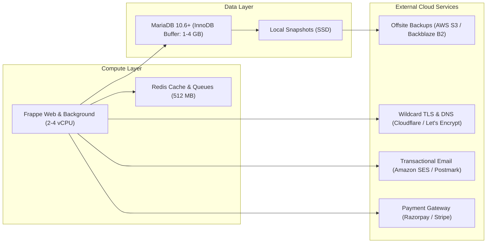

# Capacity Planning and Infrastructure Cost Model

## 1. Scope, Methodology, and Ground Truth Baseline

This capacity plan and cost model projects infrastructure requirements and operational expenses for the Departmental Store SaaS platform. It models three concrete customer cohorts based on the actual measured footprint of the ERPNext Docker stack and performance benchmarks recorded in `docs/testing/artifacts/scale-and-capacity-results.json`.

> [!IMPORTANT]
> **Measured Baseline vs. Estimates:**
> - Measured container memory on host (Docker 9-container stack): **~910 MiB aggregate RSS**.
> - Measured database throughput: **~70 requests/second** on liveness, **~8 bills/second** on sequential backlog recovery.
> - Measured per-sale latency: **p50 = 456ms** (isolated), **p50 = 1320ms** (5 concurrent counters burst).
> - Measured disk usage: **~5.8% of host disk**; MariaDB raw data size for 500 items + 300 invoices: **~18 MB**.
> - Hardware utilized for local benchmarks: 12th Gen Intel Core i5 / AMD Ryzen 8-core equivalent, 32 GiB RAM, NVMe SSD.

---

## 2. Workload Cohort Sizing and Scaling Profiles

| Parameter | Profile A (Single Store Pilot) | Profile B (Small Supervised Cohort) | Profile C (Growth Cohort) |
| :--- | :--- | :--- | :--- |
| **Active Shops / Tenants** | 1 shop | 5 shops | 50 shops |
| **Billing Counters (POS)** | 2–3 counters | 12–15 counters | 120–150 counters |
| **Catalog SKUs per Shop** | ~2,500 items | ~3,000 items (15k total) | ~3,000 items (150k total) |
| **Daily Transactions (Bills)** | 450–750 bills/day | 2,500–3,500 bills/day | 25,000–45,000 bills/day |
| **Monthly Transaction Volume** | ~18,000 bills/mo | ~90,000 bills/mo | ~900,000 bills/mo |
| **Target Concurrent Web Workers** | 2 Gunicorn workers | 4 Gunicorn workers | 16 Gunicorn workers (2–3 nodes) |
| **MariaDB Connection Budget** | 25 connections | 60 connections | 200 connections |
| **Database Storage Growth** | ~150 MB / month | ~750 MB / month | ~7.5 GB / month |

---

## 3. Infrastructure Capacity Specifications

### 3.1 Compute Sizing (CPU & RAM)
- **Profile A (1 Store):** 2 vCPU, 4 GB RAM. Minimum viable dedicated VPS (e.g. Hetzner CX22 / DigitalOcean 4GB).
- **Profile B (5 Stores):** 4 vCPU, 8 GB RAM. Recommended staging/production node (e.g. Hetzner CPX31 / DigitalOcean 8GB).
- **Profile C (50 Stores):** 8–16 vCPU, 32 GB RAM across 2 clustered nodes (1 Web/App node, 1 dedicated MariaDB Galera/Managed Database node).

### 3.2 Storage Sizing and Retention
- **Transaction Footprint:** An ERPNext `Sales Invoice` with 5 line items, GL entries, payment schedule, and stock ledger entry consumes ~8.5 KB of MariaDB storage.
- **Monthly Growth:**
  - Profile A: ~18,000 bills $\times$ 8.5 KB $\approx$ **153 MB / month**.
  - Profile B: ~90,000 bills $\times$ 8.5 KB $\approx$ **765 MB / month**.
  - Profile C: ~900,000 bills $\times$ 8.5 KB $\approx$ **7.65 GB / month**.
- **Backup Retention Policy:** Daily incremental snapshots kept for 30 days; weekly full dumps kept for 12 months; monthly ledger archives kept for 7 years (statutory GST requirement).

---

## 4. Comprehensive Cost Model (Monthly Projections)

All costs are projected across **Low (Self-Hosted/Budget VPS)**, **Expected (Standard Production Hosting)**, and **High (Enterprise Managed Redundant)** scenarios. Currency shown in INR (₹) and USD ($) at ₹84/$1.

### 4.1 Profile A: Single Store Pilot (1 Shop, 2–3 Counters)

| Category | Component / Provider | Low Scenario | Expected Scenario | High Scenario | Notes |
| :--- | :--- | :--- | :--- | :--- | :--- |
| **Compute & OS** | 2 vCPU, 4GB RAM VPS | ₹840 ($10) | ₹1,680 ($20) | ₹3,360 ($40) | Hetzner Cloud / DigitalOcean / Linode |
| **Database Storage** | 50 GB NVMe SSD | Included | Included | ₹840 ($10) | Block storage add-on |
| **Redis & Queues** | Co-located container | ₹0 | ₹0 | Included | Runs on same host |
| **Offsite Backups** | Backblaze B2 / AWS S3 (100GB) | ₹84 ($1) | ₹168 ($2) | ₹420 ($5) | Encrypted daily offsite snapshots |
| **Domain & TLS** | Wildcard `.departmentstore.in` + Let's Encrypt | ₹125 ($1.5) | ₹125 ($1.5) | ₹250 ($3) | Annual domain amortized monthly |
| **Monitoring & Logs** | Self-hosted Prometheus/Grafana or Loki | ₹0 | ₹0 | ₹840 ($10) | Local telemetry exporter |
| **Transactional Email** | Amazon SES (3,000 emails/mo) | ₹25 ($0.3) | ₹84 ($1) | ₹168 ($2) | Customer receipts & onboarding tokens |
| **Payment Gateway** | Razorpay / Stripe (SaaS sub fees) | ₹0 | ₹100 ($1.2) | ₹200 ($2.4) | 2% on platform billing (not store sales) |
| **Total Monthly Cost** | | **₹1,074 ($12.8)** | **₹2,157 ($25.7)** | **₹6,078 ($72.4)** | |

---

### 4.2 Profile B: Small Supervised Cohort (5 Shops, 12–15 Counters)

| Category | Component / Provider | Low Scenario | Expected Scenario | High Scenario | Notes |
| :--- | :--- | :--- | :--- | :--- | :--- |
| **Compute & OS** | 4 vCPU, 8GB RAM VPS | ₹1,680 ($20) | ₹3,360 ($40) | ₹6,720 ($80) | Handles 5 concurrent shops smoothly |
| **Database Storage** | 100 GB NVMe SSD | Included | ₹420 ($5) | ₹1,680 ($20) | Volume expansion |
| **Redis & Queues** | Co-located container | ₹0 | ₹0 | ₹840 ($10) | In-memory Redis cache + queue |
| **Offsite Backups** | S3 / B2 (300 GB with lifecycle) | ₹250 ($3) | ₹420 ($5) | ₹1,000 ($12) | Automated nightly multi-tenant backup |
| **Domain & TLS** | Wildcard SSL + Cloudflare CDN | ₹125 ($1.5) | ₹250 ($3) | ₹1,680 ($20) | Cloudflare Pro optional for DDoS |
| **Monitoring & Alerting** | Better Uptime / Grafana Cloud Free | ₹0 | ₹840 ($10) | ₹2,520 ($30) | Health probes, latency alerting, PagerDuty |
| **Transactional Email/SMS** | Amazon SES + DLT SMS (India) | ₹250 ($3) | ₹840 ($10) | ₹1,680 ($20) | OTP verification & daily summaries |
| **Payment Gateway** | Gateway commissions on SaaS fees | ₹250 ($3) | ₹500 ($6) | ₹1,000 ($12) | Platform subscription charges |
| **Total Monthly Cost** | | **₹2,555 ($30.5)** | **₹6,630 ($79.0)** | **₹17,120 ($204)** | **Cost per shop: ₹511 – ₹1,326/mo** |

---

### 4.3 Profile C: Growth Customer Cohort (50 Shops, 120–150 Counters)

| Category | Component / Provider | Low Scenario | Expected Scenario | High Scenario | Notes |
| :--- | :--- | :--- | :--- | :--- | :--- |
| **Compute (App/Web)** | 2 $\times$ 8 vCPU, 16GB RAM Nodes | ₹6,720 ($80) | ₹13,440 ($160) | ₹25,200 ($300) | Load-balanced Gunicorn clusters |
| **Managed MariaDB** | Dedicated DB (8 vCPU, 16GB, NVMe) | ₹6,720 ($80) | ₹12,600 ($150) | ₹21,000 ($250) | Managed database with automated replication |
| **Database Storage** | 500 GB NVMe Storage + Growth | ₹2,100 ($25) | ₹4,200 ($50) | ₹8,400 ($100) | High IOPS provisioned SSD |
| **Managed Redis** | Dedicated Redis Cluster (2GB) | ₹840 ($10) | ₹1,680 ($20) | ₹3,360 ($40) | Decoupled cache & queue broker |
| **Offsite Storage** | S3 / B2 (2 TB lifecycle retention) | ₹1,260 ($15) | ₹2,520 ($30) | ₹5,040 ($60) | Cross-region backup replication |
| **Domain, CDN, TLS** | Cloudflare Business / Enterprise | ₹250 ($3) | ₹1,680 ($20) | ₹16,800 ($200) | WAF, DDoS mitigation, edge caching |
| **Observability** | Datadog / Grafana Cloud / Sentry | ₹1,680 ($20) | ₹5,040 ($60) | ₹12,600 ($150) | APM, error tracking, synthetic probes |
| **Transactional Messaging** | Amazon SES + Fast2SMS / Gupshup | ₹1,260 ($15) | ₹3,360 ($40) | ₹8,400 ($100) | Bulk SMS OTP & daily reports |
| **Mobile Distribution** | Apple Dev Program + Google Play | ₹840 ($10) | ₹840 ($10) | ₹840 ($10) | Annual app developer licenses |
| **Billing & Reconciliation** | Payment gateway subscription API | ₹2,520 ($30) | ₹5,040 ($60) | ₹10,080 ($120) | Automated subscription recurring debits |
| **Total Monthly Cost** | | **₹24,190 ($288)** | **₹50,400 ($600)** | **₹112,720 ($1,342)** | **Cost per shop: ₹484 – ₹1,008/mo** |

---

## 5. Commercial Margins and Unit Economics

Assuming the platform prices its SaaS subscription at standard departmental store market tiers:
- **Starter Plan:** ₹1,499 / month (1 counter)
- **Growth Plan:** ₹2,999 / month (up to 3 counters)
- **Enterprise Plan:** ₹4,999 / month (up to 6 counters)

### Blended Revenue vs. Infrastructure Margin (Profile B: 5 Shops)
- **Projected Monthly Revenue:** 5 shops $\times$ ₹2,999 (Growth avg) = **₹14,995 / month**.
- **Expected Infrastructure Cost:** **₹6,630 / month**.
- **Gross Infrastructure Margin:** $$\frac{14,995 - 6,630}{14,995} = \mathbf{55.8\%}$$.

### Blended Revenue vs. Infrastructure Margin (Profile C: 50 Shops)
- **Projected Monthly Revenue:** 50 shops $\times$ ₹2,999 (Growth avg) = **₹149,950 / month**.
- **Expected Infrastructure Cost:** **₹50,400 / month**.
- **Gross Infrastructure Margin:** $$\frac{149,950 - 50,400}{149,950} = \mathbf{66.4\%}$$.

---

## 6. Infrastructure Upgrade Triggers and Action Thresholds

Do not purchase hardware or upgrade plans prematurely. Monitor operational telemetry against these explicit thresholds:

1. **CPU Saturation:** If sustained node CPU exceeds **70% for > 15 minutes**, scale Gunicorn workers from 4 to 8, or vertically upgrade compute core count.
2. **Memory Pressure:** If available RAM drops below **1.5 GB**, increase host memory to prevent MariaDB buffer pool swapping.
3. **Database Concurrency:** If `Threads_connected` exceeds **60 concurrent connections**, increase `max_connections` to 250 and tune MariaDB thread cache.
4. **Queue Latency:** If Redis `default` queue depth exceeds **50 items**, add a dedicated background queue worker container.
5. **Disk Headroom:** If disk free space drops below **20%**, attach additional block storage volumes before the nightly backup run.
