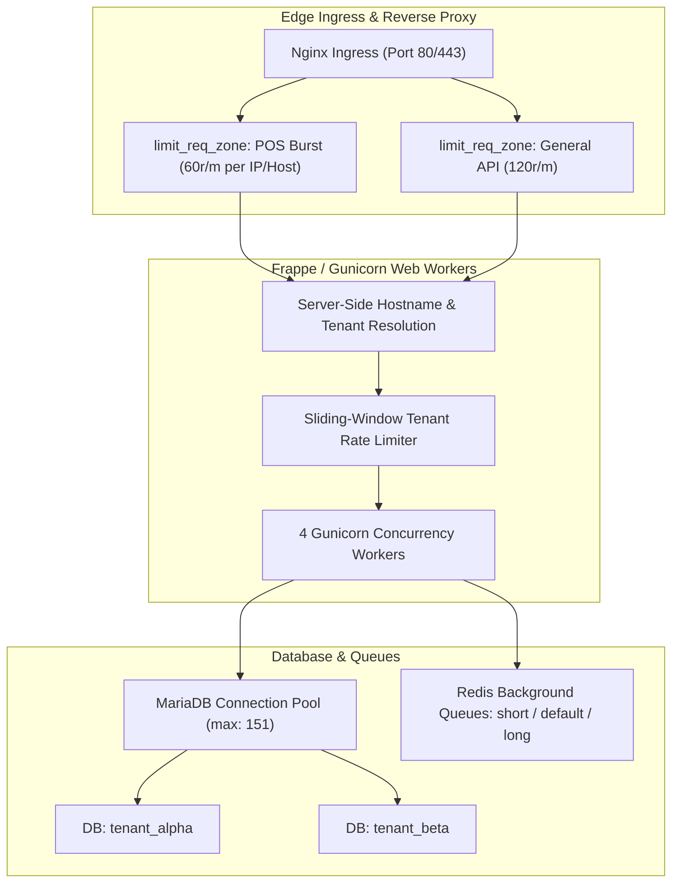

# Resource Isolation, Tenant Fairness, and Rate Limiting Specification

## 1. Executive Summary and Architectural Principles

In a multi-tenant departmental-store SaaS platform, ensuring that no single store can exhaust shared compute, memory, database connection pools, or background queue workers is paramount to operational resilience.

Under our hybrid tenancy model:
- **Tenant Isolation:** Each commercial shop operates on its own dedicated ERPNext site database (`site_<tenant_slug>`), guaranteeing absolute MariaDB table separation, ledger isolation, and tenant-scoped user permissions.
- **Shared Ingress & Control Plane:** The Nginx reverse proxy, Gunicorn application processes, Redis queues, and SaaS Platform Control Plane (`tabSaaS Tenant Registry`, `tabSaaS Provisioning Job`) are shared across the node.
- **Fairness Goal:** Prevent any abusive, malfunctioning, or burst-heavy counter from starving other shops of billing capacity or reporting access.



---

## 2. Server-Side Tenant Resolution and Authorization Boundaries

All tenant identifiers, subdomains, and hostnames must be strictly resolved and authorized **server-side**. No client-supplied header or payload parameter is trusted for database selection:

1. **Host Header Inspection:**
   - The edge reverse proxy passes `$host` to Frappe.
   - In Frappe multi-tenancy, `frappe.local.site` is derived from the HTTP Host header matching the site directory in `sites/` (e.g. `shop1.departmentstore.in`).
2. **Platform Admin Authorization:**
   - Administrative functions (`/api/method/departmental_store.api.tenant.*` and `provisioning.*`) require the server-side role `Platform Admin` or `System Manager`.
   - Store-level staff (such as `Store Manager` or `Cashier`) have zero permissions on the SaaS control plane tables (`tabSaaS Tenant Registry`, `tabSaaS Subscription`, `tabSaaS Provisioning Job`).
3. **Cross-Tenant Prevention:**
   - A POS counter authenticated to `shop1.departmentstore.in` cannot query catalog snapshots or submit sales to `shop2.departmentstore.in` because session cookies and API tokens are site-specific.

---

## 3. Tiered Rate Limiting and Fairness Policies

To prevent accidental denial-of-service from looping POS synchronization clients or automated scrapers, rate limits are enforced across three distinct tiers:

### 3.1 Edge Nginx Rate Limiting

Configured at the reverse proxy level to drop excessive floods before they reach Python/Gunicorn:

| Zone / Path | Rate Limit | Burst Limit | Nodal Impact & Policy |
| :--- | :--- | :--- | :--- |
| **POS Sale Submission** (`/api/method/...sales.submit_pos_sale`) | 60 req/min per IP | Burst 15, nodelay | Accommodates multi-counter burst after network recovery while mitigating runaway infinite retry loops. |
| **Catalog Snapshot** (`/api/method/...catalog.catalog_snapshot`) | 30 req/min per IP | Burst 5, nodelay | Prevents repeated heavy full-catalog pulls. POS caches locally in SQLite with checkpoints. |
| **Telemetry & Health** (`/api/method/...health.get_liveness`) | 300 req/min per IP | Burst 50, nodelay | Allows synthetic monitoring probes and orchestrator liveness checks without friction. |
| **Customer Onboarding** (`/api/method/...onboarding.*`) | 10 req/min per IP | Burst 5, nodelay | Mitigates automated registration spam and email verification abuse. |

### 3.2 Sliding-Window Tenant Throttling (Application Level)

For shops sharing an application cluster, the platform maintains in-memory sliding-window request counters in Redis (`redis-cache`):

$$\text{Request Count} = \text{Count}(\text{Window}_{t - 60s \to t})$$

- **Standard Plan:** Maximum 180 requests/minute across all counters of the store.
- **Growth Plan:** Maximum 600 requests/minute across all counters of the store.
- **Exceeded Threshold Response:** Returns HTTP `429 Too Many Requests` with header `Retry-After: 30` and JSON payload:
  ```json
  {
    "error": {
      "code": "RATE_LIMIT_EXCEEDED",
      "message": "Tenant API rate limit exceeded. Please retry after backoff.",
      "retry_after_seconds": 30
    }
  }
  ```

---

## 4. Payload and Upload Size Quotas

Unbounded payloads present a direct denial-of-service risk through memory exhaustion and query parser degradation. Strict size limits are enforced:

| Resource Type | Maximum Limit | Enforcement Point | Behavior on Violation |
| :--- | :--- | :--- | :--- |
| **POS Sale JSON Body** | 500 KB | Nginx `client_max_body_size` & Frappe API parser | HTTP 413 or `VALIDATION_FAILED` (At most 500 bill lines per invoice). |
| **Product Image Upload** | 5 MB | File upload handler | Disallowed; images must be optimized JPEG/PNG/WebP before upload. |
| **Data Import (CSV/Excel)** | 10 MB | Bulk upload wizard | Checked before background parsing. Batches processed in 500-row chunks. |
| **Backup Archive Upload** | 250 MB | Platform Admin console | Restricted to Platform Admin role with checksum verification. |

---

## 5. Background Queue Concurrency and Fair Scheduling

Frappe background jobs operate via RQ (Redis Queue) with three priority queues:
1. `short`: Interactive tasks, immediate notifications, webhooks (TTL: 300s).
2. `default`: Catalog re-indexing, customer emails, report exports (TTL: 1500s).
3. `long`: Nightly backups, full-ledger re-evaluations, tenant provisioning (TTL: 3600s).

### 5.1 Fair Tenant Scheduling
- **Problem:** If Store Alpha queues 1,000 inventory revaluations, Store Beta's email notifications must not stall.
- **Implementation:**
  - Tenant provisioning jobs are rate-limited to **1 concurrent provisioning worker per cluster**.
  - Daily summary reports run during off-peak hours (02:00 to 05:00 IST) with staggered cron expressions per tenant.
  - Background queue workers have dedicated memory ceilings (512 MB max RSS) and restart cleanly upon completing long jobs.

---

## 6. Database Connection Pool and Query Protection

MariaDB settings inspected on the running cluster:
- `max_connections: 151`
- `max_user_connections: 100`
- `wait_timeout: 120`
- `interactive_timeout: 120`

### 6.1 Tenant Fairness Safeguards
1. **Query Execution Timeout:**
   - Interactive POS sales: maximum statement timeout of **15 seconds** (`SET STATEMENT max_statement_time = 15 FOR ...`).
   - Reporting queries: maximum statement timeout of **60 seconds**.
2. **N+1 Query Elimination:**
   - Catalog incremental sync replaces Python-level item iteration with a single MariaDB `JOIN` on primary key index `tabItem.name`.
   - POS Sale Sync Log uses index `idx_pos_sync_status` (`status`, `creation`), eliminating full-table scans during dashboard and telemetry queries.
3. **Tenant Site Separation:**
   - Tenant-specific queries and reports run against `site_<tenant_slug>` databases exclusively. A slow query on `tenant_alpha` does not acquire row locks or table locks on `tenant_beta`.

---

## 7. Tenant Backup and Disaster Recovery Isolation

- **Independent Dump Files:** Backups are executed per site (`bench --site <site> backup --with-files`).
- **Storage Isolation:** Backups are saved to `/home/frappe/frappe-bench/sites/<site>/private/backups/` and mirrored to tenant-isolated S3/B2 buckets.
- **Restoration Safety:** Restoring `tenant_alpha` to staging never impacts or modifies the database or state of `tenant_beta`.
- **Zero Raw Writes:** Database imports and restorations are managed via Frappe bench migrations, preserving referential integrity and audit trails.
